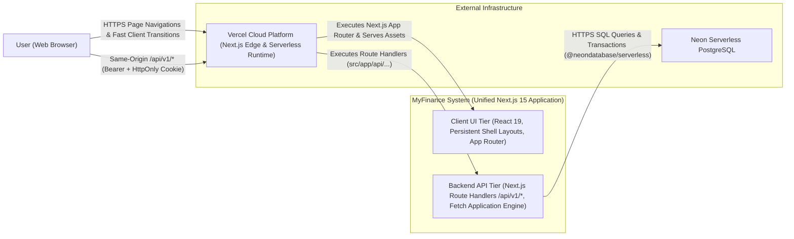
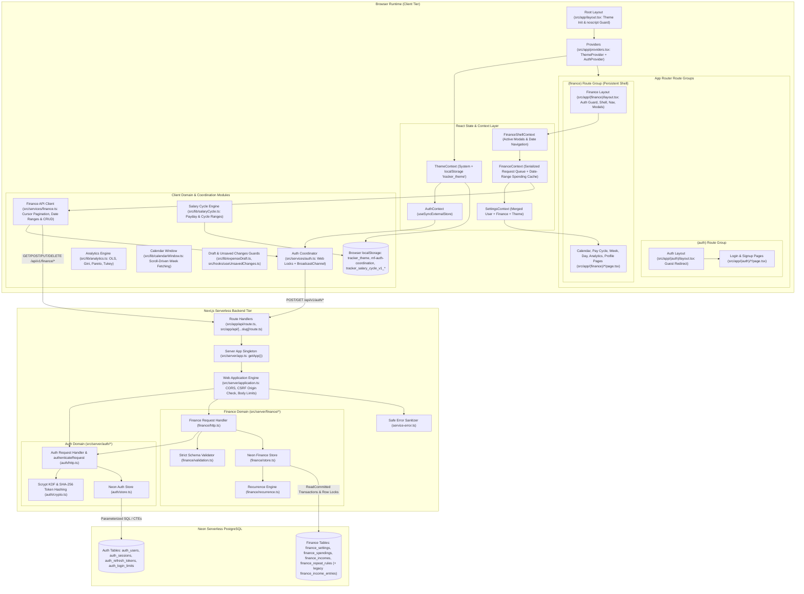
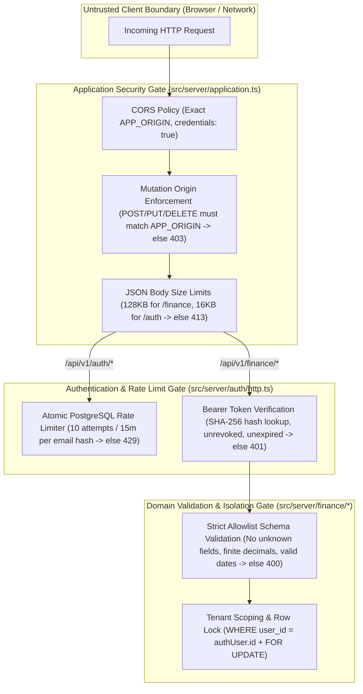

# 01. System Architecture

This document describes the high-level system architecture of **MyFinance**, including its system context, runtime containers, core subsystems, database schema, and security model.

---

## 1. System Context

**MyFinance** is a personal finance management system that enables authenticated users to track daily expenses, configure automated recurring spending rules, manage multiple income sources (salary, freelance, allowance, gifts, ...) paid once or on a daily, weekly, monthly, or yearly schedule, customize spending categories, review spending per salary (pay) cycle, and analyze spending habits through statistical insights and forecasting.

---

## 2. Container & Component Architecture

The system is architected as a unified Next.js 15 application where frontend React 19 components and backend Web standard API Route Handlers run from the repository root, communicating over a strict same-origin HTTP/JSON API contract and backed by Neon PostgreSQL.

### Architectural Principles

| Principle | Implementation Details |
| :--- | :--- |
| **Next.js App Router & Persistent Layouts** | Routes are organized under `src/app/` using App Router conventions. The `(finance)` route group shares a persistent layout (`src/app/(finance)/layout.tsx`) that mounts `FinanceProvider`, `SettingsProvider`, header navigation, and global modals (`ExpenseModal`, `MonthlyIncomeModal`) once. Page transitions (`next/link`) update page-level content instantly without unmounting shell state or triggering redundant initial data loads. |
| **Same-Origin Unified Routing** | Both frontend pages and `/api/v1/*` routes live on the same origin (port 5173 during development, unified domain in production). Next.js Route Handlers (`src/app/api/[...slug]/route.ts`) dispatch API requests directly through the portable Web Fetch pipeline without requiring development proxy configurations or multi-service routing rewrites. |
| **Dependency Injection for Testability** | `createApplication(config, authStore, financeStore?)` in [`src/server/application.ts`](../src/server/application.ts) accepts store interfaces (`AuthStore`, `FinanceStore`), allowing fast in-memory HTTP contract tests alongside real Neon PostgreSQL integration tests without starting an external web server. |
| **Zero-Leak Error Handling** | Unexpected database or runtime errors pass through [`serviceErrorDiagnostic`](../src/server/service-error.ts), which maps known PostgreSQL/network error codes to safe operator hints and returns a generic `503 Service temporarily unavailable` to clients without exposing SQL, tokens, or connection strings. |

---

## 3. Data Architecture & Entity-Relationship Diagram

All persistent state resides in **Neon PostgreSQL** and is managed through numbered, idempotent SQL migrations in [`migrations/`](../migrations/). Every user-owned table scopes queries and mutations by `user_id`.

```mermaid
erDiagram
    auth_users ||--o{ auth_sessions : "has session families"
    auth_sessions ||--o{ auth_refresh_tokens : "tracks token history"
    auth_users ||--|| finance_settings : "owns 1:1 settings"
    auth_users ||--o{ finance_spendings : "records expenses"
    auth_users ||--o{ finance_incomes : "receives income from sources"
    auth_users ||--o{ finance_income_entries : "legacy bonuses (read-only, migrated)"
    auth_users ||--o| finance_income_migrations : "legacy income copied"
    auth_users ||--o{ finance_repeat_rules : "configures repeat rules"
    finance_repeat_rules |o--o{ finance_spendings : "generates (ON DELETE SET NULL)"

    auth_users {
        uuid id PK
        text name "1..100 chars"
        text email UK "<=254 chars, lowercase"
        text password_hash "scrypt$32768$8$1$salt$key"
        timestamptz created_at
    }

    auth_sessions {
        uuid id PK
        uuid user_id FK "ON DELETE CASCADE"
        text access_hash UK "SHA-256 of 256-bit token"
        timestamptz access_expires_at "15m TTL"
        text refresh_hash UK "SHA-256 of active refresh token"
        timestamptz refresh_expires_at "30d sliding TTL"
        timestamptz revoked_at "Nullable"
        timestamptz created_at
    }

    auth_refresh_tokens {
        text token_hash PK "SHA-256 of issued refresh token"
        uuid session_id FK "ON DELETE CASCADE"
        timestamptz created_at
    }

    auth_login_limits {
        text key_hash PK "SHA-256 of 'auth-email:' + email"
        timestamptz window_started_at "15m fixed window"
        integer attempts "Max 10 per window"
    }

    finance_settings {
        uuid user_id PK,FK "ON DELETE CASCADE"
        numeric_15_2 income "Legacy/Ignored (migrated to finance_incomes)"
        numeric_15_2 base_daily_spending "Legacy/Ignored"
        numeric_15_2 max_daily_spending "Legacy/Ignored"
        text avatar "<=2048 chars HTTP(S) URL"
        jsonb categories "Array of <=50 {id, name, color, icon}"
    }

    finance_spendings {
        uuid id PK
        uuid user_id FK "ON DELETE CASCADE"
        numeric_15_2 amount ">0..1e12"
        text description "<=1000 chars"
        text category "Historical string ID (1..100 chars)"
        date date "YYYY-MM-DD"
        time_0 time "HH:mm"
        uuid repeat_rule_id FK "Nullable, ON DELETE SET NULL"
    }

    finance_incomes {
        uuid id PK
        uuid user_id FK "ON DELETE CASCADE"
        text source "1..100 chars non-blank, e.g. Salary"
        text name "0..500 chars, e.g. employer"
        numeric_15_2 amount ">0..1e12 per payment"
        text frequency "once | daily | weekly | monthly | yearly"
        date start_date "First (or only) payment"
        date end_date "Nullable, >= start_date, NULL for once"
        timestamptz created_at
    }

    finance_income_entries {
        uuid id PK
        uuid user_id FK "ON DELETE CASCADE"
        date month "Legacy/Ignored: YYYY-MM-01"
        numeric_15_2 amount ">0..1e12"
        text description "1..500 chars non-blank"
    }

    finance_income_migrations {
        uuid user_id PK,FK "ON DELETE CASCADE"
        timestamptz migrated_at "Set by migration 005"
    }

    finance_repeat_rules {
        uuid id PK
        uuid user_id FK "ON DELETE CASCADE"
        numeric_15_2 amount ">0..1e12"
        text description "<=1000 chars"
        text category "1..100 chars"
        date start_date "YYYY-MM-DD"
        time_0 time "HH:mm"
        text frequency "daily | weekdays | weekly | monthly"
        int interval "1..365"
        jsonb days_of_week "Array of 0..6"
        text end_type "unlimited | occurrences | until_date"
        int total_occurrences "Nullable, 1..100"
        date end_date "Nullable, YYYY-MM-DD"
        int occurrences_created "Default 0"
        date last_generated_date "Nullable, YYYY-MM-DD"
        timestamptz created_at
    }
```

### Key Data Design Decisions

1. **Historical Category Preservation**:
   - `finance_spendings.category` stores the category ID string rather than a foreign key into a separate table. User categories are stored as a JSONB array in `finance_settings.categories`.
   - When creating or updating a spending or repeat rule, the server locks the user's `finance_settings` row (`SELECT user_id FROM finance_settings WHERE user_id = $1 FOR UPDATE`) and verifies that the category currently exists in [`src/server/finance/store.ts`](../src/server/finance/store.ts).
   - If a user later removes a category from their settings, historical spendings retain their original category string and render with a graceful fallback in the UI.
2. **UUID Cursor Pagination**:
   - `finance_spendings` and `finance_incomes` are indexed by `(user_id, id)` and paginated in ascending UUID order (`id > $2::uuid ORDER BY id ASC LIMIT $3`).
   - `GET /spendings` optionally accepts `startDate` / `endDate` (inclusive `YYYY-MM-DD`) to restrict the traversal to a date window; pagination order stays UUID-based.
   - Deleting a boundary record never invalidates the cursor value, and client loaders traverse pages of up to 500 records until `nextCursor` is `null`.
3. **Non-Destructive Repeat Rule Deletion**:
   - `finance_spendings.repeat_rule_id` references `finance_repeat_rules(id) ON DELETE SET NULL`.
   - When a user stops a repeat rule (`DELETE /api/v1/finance/repeat-rules/:id?deleteFuture=true`), upcoming generated spendings (`date >= today`, UTC) are deleted while past transactions remain intact with `repeat_rule_id = NULL`.
4. **Income Sources Instead of a Single Income Number**:
   - Each `finance_incomes` row is one income stream with an amount **per payment** and a schedule (`once`, `daily`, `weekly`, `monthly`, `yearly`, from `start_date` until the optional `end_date`). Nothing is materialized per month: the client computes a month's income as the sum of `amount × occurrences in that month` ([`src/lib/income.ts`](../src/lib/income.ts)).
   - Monthly and yearly income pays on the start date's day, moved to the last day of shorter months; weekly income repeats on the start date's weekday.
   - Migration `005_incomes.sql` copied the old data: `finance_settings.income` → a monthly `Salary` income starting at the earlier of the account creation month and the first spending month, and each `finance_income_entries` row → a one-time `Other` income on the first day of its month. The legacy column and table are kept but no longer read or written; `finance_income_migrations` marks copied users so reruns never duplicate or restore rows.
5. **Device-Local Preferences**:
   - Not everything is stored in Neon. The light/dark theme (`tracker_theme`), auth coordination metadata (`mf-auth-coordination`, no tokens), and the salary cycle configuration (`tracker_salary_cycle_v1_<userId>`) live in browser `localStorage` and do not sync across devices.

---

## 4. Security & Trust Boundaries

- **Password Security**: Built-in Node `crypto.scrypt` (`N=32768, r=8, p=1`, 16-byte random salt, 64-byte key) with `timingSafeEqual` verification. Login attempts against non-existent emails execute a full dummy KDF derivation (`DUMMY_PASSWORD_HASH`) in [`src/server/auth/crypto.ts`](../src/server/auth/crypto.ts) to mitigate timing enumeration.
- **CSRF Defense**: Every state-changing request (`POST`, `PUT`, `DELETE`) requires an `Origin` header that strictly matches `config.appOrigin`. Furthermore, `/api/v1/finance/*` routes authenticate exclusively via the `Authorization: Bearer <token>` header, never cookies alone.
- **Token Replay Detection**: Every refresh token ever issued for a session family is recorded in `auth_refresh_tokens`. If an already-rotated refresh token is presented again, the atomic `UPDATE` in `store.rotate()` detects that `refresh_hash != $1` on the locked `auth_sessions` row and immediately sets `revoked_at = now()` for the entire session family.
