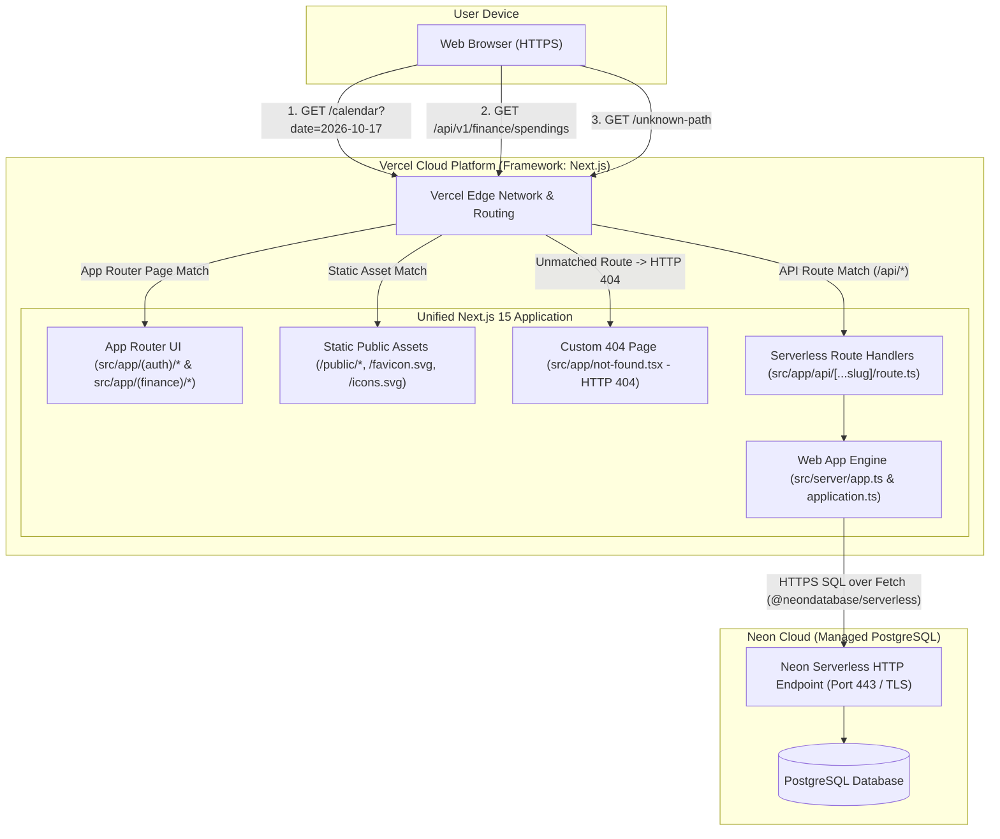
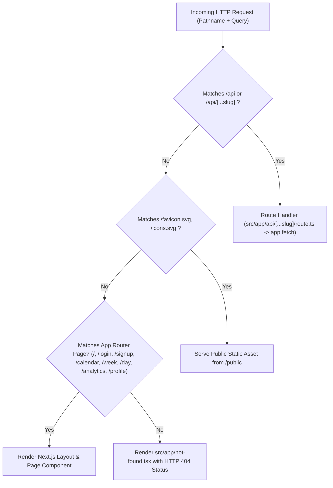
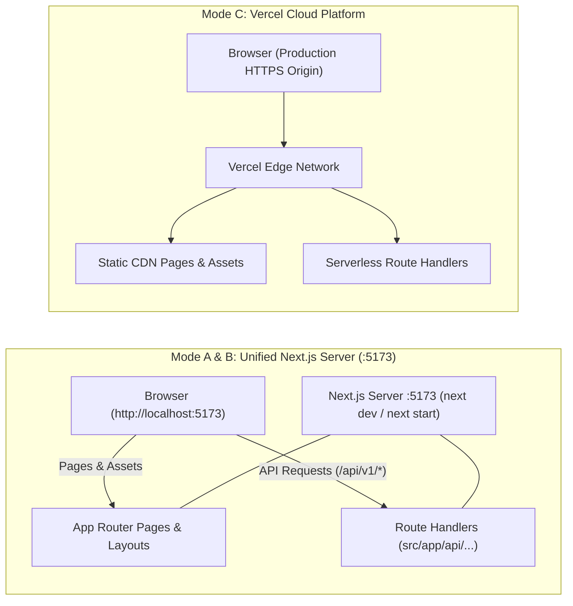
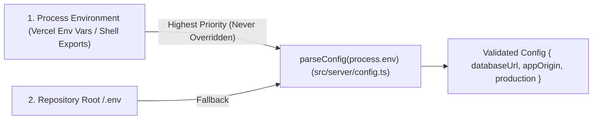

# 02. Deployment Architecture

This document details the deployment topology, routing mechanics, environment configurations, and runtime modes for **MyFinance** across local development, preview, and production environments.

---

## 1. Production Deployment Topology (Vercel + Neon)

In production and preview environments, **MyFinance** deploys from the repository root to **Vercel** as a unified **Next.js** application using the root configuration in [`vercel.json`](../vercel.json), paired with a managed **Neon Serverless PostgreSQL** database.



### Vercel Next.js Deployment Specification

Defined in [`vercel.json`](../vercel.json):

```json
{
  "$schema": "https://openapi.vercel.sh/vercel.json",
  "framework": "nextjs"
}
```

By specifying `framework: "nextjs"`, Vercel automatically detects the Next.js App Router project at the root directory, compiles the pages and layouts into optimized serverless edge bundles, deploys `/api/*` dynamic route handlers as serverless functions, and serves static assets from `public/` via global CDN edges.

---

## 2. Request Routing & URL Handling

Routing is orchestrated natively by the Next.js App Router:

1. **API Requests (`/api/*`)**: Handled by the dynamic route handlers in [`src/app/api/route.ts`](../src/app/api/route.ts) and [`src/app/api/[...slug]/route.ts`](../src/app/api/[...slug]/route.ts), which pass incoming standard Web `Request` objects directly to `app.fetch(request)`.
2. **Persistent Shell Layout (`(finance)`)**: Authenticated routes (`/calendar`, `/week`, `/day`, `/analytics`, `/profile`) are grouped under `src/app/(finance)/`. Navigations between these routes preserve the layout shell (`src/app/(finance)/layout.tsx`), header navigation, and modal dialogs while updating the page view and query string (e.g., `?date=2026-10-17`).
3. **Auth Route Group (`(auth)`)**: `/login` and `/signup` are grouped under `src/app/(auth)/` with their own lightweight layout that redirects already-authenticated visitors to `/calendar` or their requested return URL.
4. **Root Index (`/`)**: Handled by `src/app/page.tsx`, redirecting authenticated users to `/calendar` and guests to `/login`.
5. **Static Assets & Architecture Documentation**: Files in `public/` (such as `favicon.svg` and `icons.svg`) and pre-built architecture documentation in `public/docs/` (`index.html`, `01..07-*.html`, assets) are served directly by Vercel CDN edges. Navigating to `/docs` redirects to `/docs/index.html` via [`next.config.ts`](../next.config.ts).
6. **404 Not Found**: Unknown paths trigger `src/app/not-found.tsx` with genuine HTTP 404 status and branded MyFinance styling.



---

## 3. Execution Environments & Local Development Topologies

The project supports three execution modes:

### Mode A: Local Development (`npm run dev`)
- Starts Next.js development server on port **5173** (`next dev -p 5173`).
- Matches the default local origin `APP_ORIGIN=http://localhost:5173`.
- Serves both frontend App Router pages and `/api/v1/*` Route Handlers from the **same origin**. No development reverse proxy is required!

### Mode B: Production Build Preview (`npm run build && npm run start`)
- `npm run build` compiles the Next.js application into `.next/`.
- `npm run start` launches the production Next.js server on port **5173** (`next start -p 5173`), serving optimized production bundles and route handlers on the same origin.

### Mode C: Vercel Cloud Platform / `vercel dev`
- Deploys on Vercel with automatic edge routing, serverless Route Handlers, and CDN asset distribution.
- In `vercel dev`, Vercel emulates the production cloud environment locally.



---

## 4. Environment Configuration & Precedence

Configuration is resolved and validated at startup by [`src/server/config.ts`](../src/server/config.ts).



### Environment Variables Reference

| Variable | Scope | Required | Validation & Behavior |
| :--- | :--- | :--- | :--- |
| `DATABASE_URL` | Next.js Server & Migration CLI | **Yes** | Must be a valid `postgres://` or `postgresql://` URL with hostname, username, and database name. Never exposed to the client or `NEXT_PUBLIC_*` variables. |
| `APP_ORIGIN` | Next.js Server | **Yes** (Defaults to `http://localhost:5173` locally) | Exact browser origin (`scheme://host[:port]`) with no path, credentials, query, or wildcard. Must use `https://` when `production` is `true`. Enforced by CORS and strict mutation `Origin` checks. |
| `NODE_ENV` | Next.js Server / Build | No | When `"production"`, enables `production` mode (requires HTTPS `APP_ORIGIN` and sets `Secure` flag on `mf_refresh` cookie). Set automatically by `next build` and `next start`. |
| `VERCEL` / `VERCEL_ENV` | Platform | Auto | When `VERCEL="1"` and `VERCEL_ENV !== "development"`, enables `production` mode automatically. |
| `PORT` | Local HTTP Server (`app.ts listen`) | No | Defaults to `0` or custom port when using standalone HTTP server listener (e.g. in test suites). |
| `AUTH_TEST_DATABASE_URL` | Test Suite | Optional | Isolated, pre-migrated Neon PostgreSQL URL for running real SQL concurrency & auth integration tests (`test/neon.test.ts`). |
| `FINANCE_TEST_DATABASE_URL` | Test Suite | Optional | Isolated, pre-migrated Neon PostgreSQL URL for running real SQL finance & category-lock race tests (`test/finance-neon.test.ts`). |
