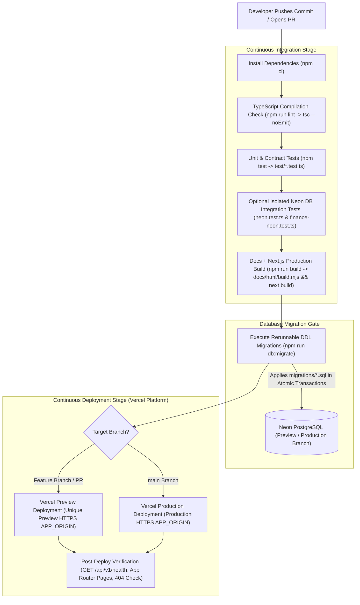
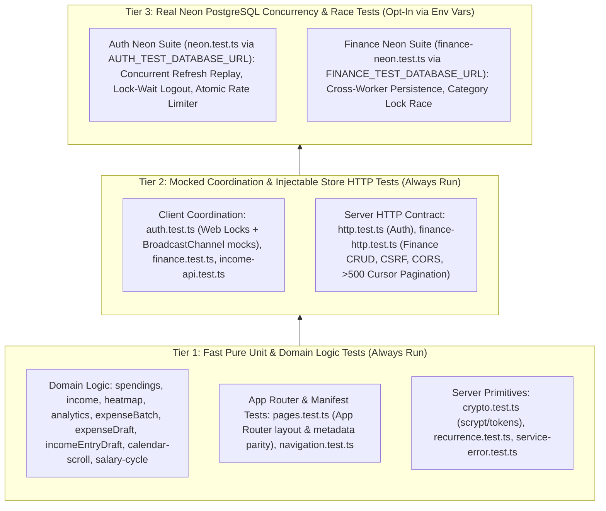
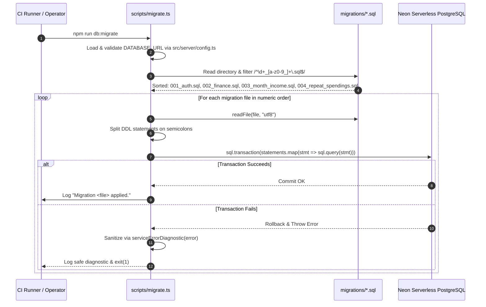
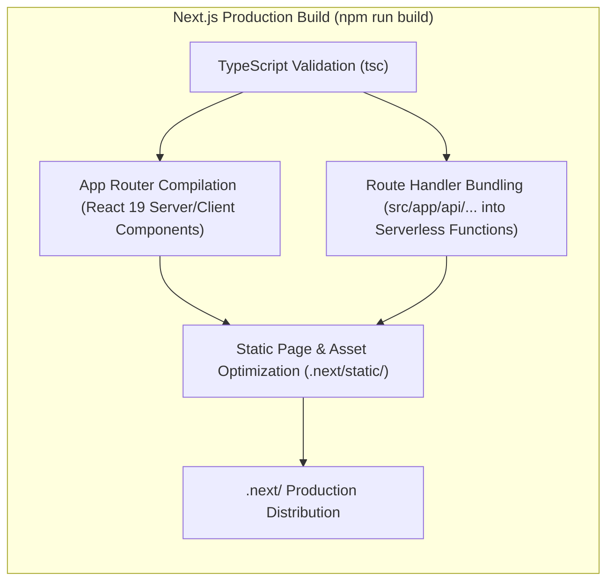

# 03. CI/CD Architecture

This document describes the Continuous Integration and Continuous Deployment (CI/CD) architecture for **MyFinance**, including static analysis, automated testing tiers, Next.js build verification, idempotent database migrations, and Vercel preview/production promotion workflows.

---

## 1. End-to-End CI/CD Pipeline Architecture

> **Status: recommended pipeline, not yet automated.** The repository currently contains no CI configuration (no `.github/workflows/` or equivalent). Deployment relies on Vercel's Git integration, which runs `npm run build` on push. Type checking, tests, and `npm run db:migrate` must be run manually (or wired into a CI workflow) before merging and deploying. The diagram below is the target pipeline that the existing npm scripts support.

The delivery pipeline ensures that every code change passes static type checking, unit tests, HTTP contract tests, and Next.js production build verification before deploying to Vercel Preview or Production environments.

---

## 2. Automated Testing Architecture

**MyFinance** uses Node.js's native test runner (`node:test`) paired with `tsx` (`node --import tsx --test test/*.test.ts`), avoiding heavy third-party testing frameworks while executing modern TypeScript modules with zero intermediate compile steps.

### Test Suites Inventory

| Suite / Test File | Purpose & Focus Area |
| :--- | :--- |
| [`test/pages.test.ts`](../test/pages.test.ts) | Verifies that all `src/lib/pages.ts` entries (including `/cycle`) map to valid Next.js App Router files (`src/app/**/page.tsx`), root layout branding, and `vercel.json` framework configuration. |
| [`test/navigation.test.ts`](../test/navigation.test.ts) | Validates date query parsing (`?date=YYYY-MM-DD`), calendar date preservation across UTC boundaries, and `safeReturnPath` open-redirect prevention. |
| [`test/auth.test.ts`](../test/auth.test.ts) | Simulates multi-tab Web Locks mutual exclusion, BroadcastChannel session broadcasting, memory token access, and auto-refresh intervals. |
| [`test/finance.test.ts`](../test/finance.test.ts) | Tests `/api/v1/finance` typed client, automatic cursor-pagination loop detection, and CRUD operations. |
| [`test/income-api.test.ts`](../test/income-api.test.ts) | Verifies monthly bonus income API endpoints and input validation. |
| [`test/spendings.test.ts`](../test/spendings.test.ts) | Tests daily spendings aggregation, filtering, and compact VND currency formatting. |
| [`test/income.test.ts`](../test/income.test.ts) | Tests effective monthly income calculation (recurring base + month-specific bonus income). |
| [`test/heatmap.test.ts`](../test/heatmap.test.ts) | Validates calendar spending intensity RGBA scaling. |
| [`test/expense-draft.test.ts`](../test/expense-draft.test.ts) & [`test/income-entry-draft.test.ts`](../test/income-entry-draft.test.ts) | Tests dirty-state detection and reset semantics for unsaved form drafts. |
| [`test/expense-batch.test.ts`](../test/expense-batch.test.ts) | Tests repeat rule creation and multi-expense batch submission. |
| [`test/calendar-scroll.test.ts`](../test/calendar-scroll.test.ts) | Verifies calendar window helpers: scroll direction, month range expansion, and scroll-driven week fetch batches (`src/lib/calendarWindow.ts`). |
| [`test/salary-cycle.test.ts`](../test/salary-cycle.test.ts) | Verifies salary cycle math: payday clamping, weekend-to-Monday shift, per-month delays, cycle start/end with and without the next payday, and active-cycle resolution (`src/lib/salaryCycle.ts`). |
| [`test/crypto.test.ts`](../test/crypto.test.ts) | Validates scrypt password hashing, timing-safe equality, dummy KDF, and token generators. |
| [`test/http.test.ts`](../test/http.test.ts) | Tests `/api/v1/auth` HTTP endpoints: login, register, refresh rotation, rate limiting (10 attempts / 15m), and CSRF origin protection. |
| [`test/finance-http.test.ts`](../test/finance-http.test.ts) | Tests `/api/v1/finance` HTTP endpoints: settings, spendings, repeat rules, cursor pagination, and input validation. |
| [`test/recurrence.test.ts`](../test/recurrence.test.ts) | Validates occurrence generation for daily, weekdays, weekly, and monthly rules up to the 100-occurrence cap. |
| [`test/service-error.test.ts`](../test/service-error.test.ts) | Verifies zero-leak error sanitization, mapping PostgreSQL error codes to safe diagnostics. |
| [`test/neon.test.ts`](../test/neon.test.ts) | *(Integration)* Real Neon DB tests for concurrent refresh rotation, token replay detection, and rate limits. |
| [`test/finance-neon.test.ts`](../test/finance-neon.test.ts) | *(Integration)* Real Neon DB tests for row-level locking (`SELECT ... FOR UPDATE`) during concurrent category edits and expense writes. |

---

## 3. Database Migration Pipeline

Database schema changes are managed by [`scripts/migrate.ts`](../scripts/migrate.ts) (`npm run db:migrate`). The application runtime **never** executes DDL statements during normal request processing; schema migrations are strictly executed out-of-band during deployments.

### Migration Design Guarantees
- **Idempotent & Rerunnable**: Every SQL file uses `CREATE TABLE IF NOT EXISTS`, `CREATE INDEX IF NOT EXISTS`, and `ALTER TABLE ... ADD COLUMN IF NOT EXISTS`. Running `db:migrate` on every deployment safely applies newly added migrations without corrupting existing records.
- **Per-File Atomic Transactions**: Each `.sql` file executes inside a single `sql.transaction([...])` call over the Neon HTTP driver.
- **Least-Privilege Execution**: Migrations can be run using a DDL-authorized database role in CI/CD, while the Next.js runtime connection string requires only DML (`SELECT`, `INSERT`, `UPDATE`, `DELETE`) privileges.

---

## 4. Build & Artifact Generation Pipeline

When `npm run build` executes, it first regenerates the HTML documentation (`node docs/html/build.mjs`, writing `docs/html/*.html` and `public/docs/`), then Next.js compiles the entire unified application:

### CI/CD Command Reference

| Stage | Command | Purpose |
| :--- | :--- | :--- |
| **Lint / Typecheck** | `npm run lint` | Runs `tsc --noEmit` across all application, server, and test TypeScript source files. |
| **Test** | `npm test` | Runs the automated test runner across all `test/*.test.ts` test suites. |
| **Migrate DB** | `npm run db:migrate` | Applies pending numbered SQL migrations in `migrations/` to `DATABASE_URL`. |
| **Docs** | `npm run docs:build` | Regenerates the HTML documentation site from `docs/*.md` into `docs/html/` and `public/docs/` (served at `/docs`). |
| **Build** | `npm run build` | Runs `docs:build`, then compiles and optimizes the Next.js App Router application and Route Handlers for production. |
| **Start Preview** | `npm run start` | Starts the production Next.js server locally on port 5173 (`next start -p 5173`). |
