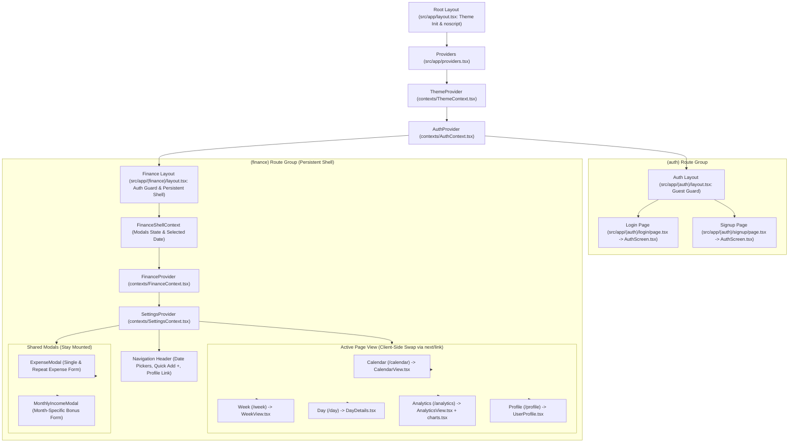
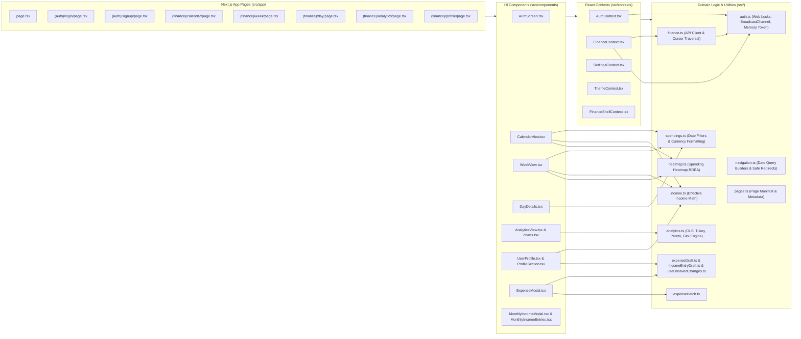
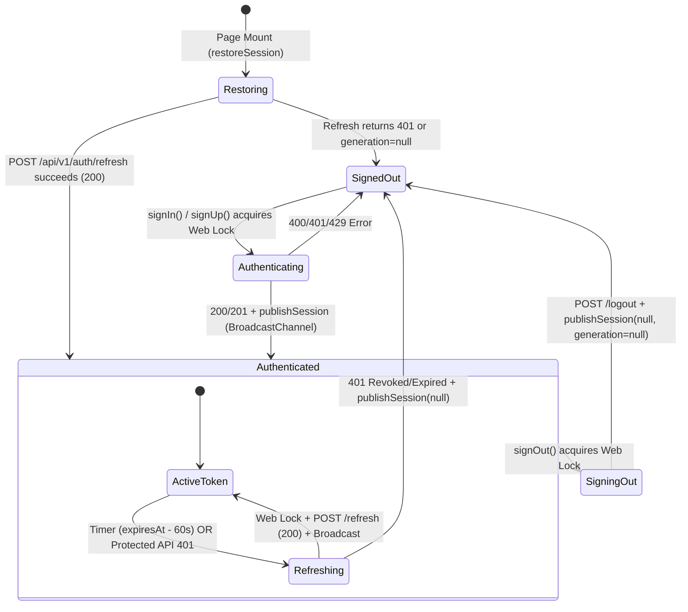
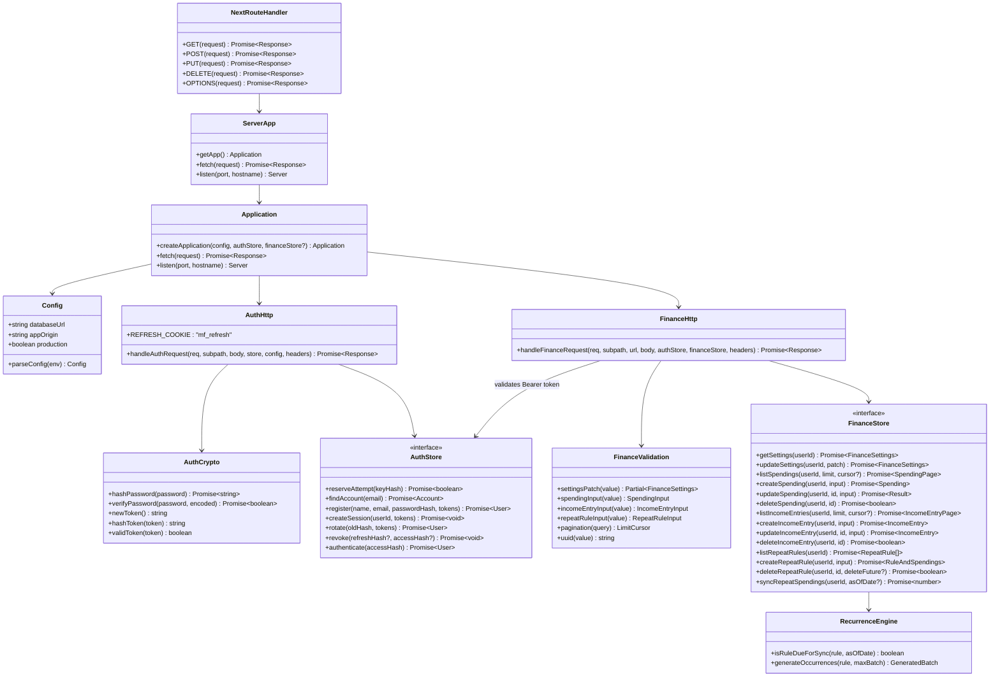
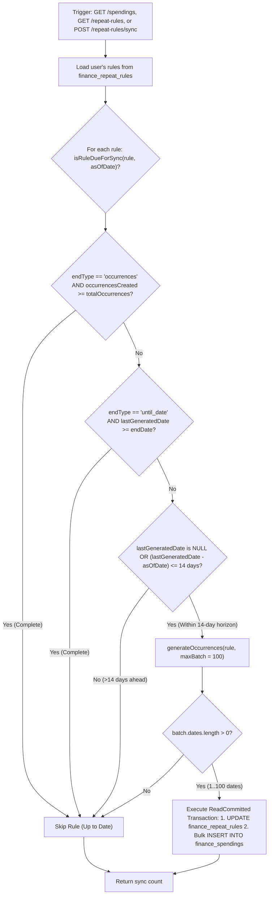

# 04. Source Code Architecture

This document provides an in-depth architectural analysis of the source code for **MyFinance**, covering the Next.js 15 App Router frontend architecture, React context hierarchy, client-side coordination, and backend Web standard request processing engine.

---

## 1. Frontend Source Code Architecture

### 1.1 Next.js App Router Component Tree & Persistent Layouts

The application frontend is structured using Next.js 15 App Router conventions with React 19. Rather than recreating layout state on every route change, route groups provide specialized shell wrappers that preserve state and eliminate redundant network queries.

#### Key Layout Responsibilities

1. **Root Layout (`src/app/layout.tsx`)**:
   - Injects a synchronous inline script to read `localStorage.getItem('tracker_theme')` and set `document.documentElement.dataset.theme` before first paint, preventing theme flash.
   - Includes `<noscript>` warning explaining that JavaScript is required to access MyFinance.
   - Wraps the entire application in `ThemeProvider` and `AuthProvider`.
2. **Auth Route Group (`src/app/(auth)/layout.tsx`)**:
   - Manages public authentication pages (`/login` and `/signup`).
   - If the user is already authenticated, automatically redirects them to their requested destination via `safeReturnPath(next)` or `/calendar`.
3. **Finance Persistent Shell (`src/app/(finance)/layout.tsx`)**:
   - Enforces authentication: unauthenticated visitors are redirected to `/login?next=...`.
   - Wraps the tree in `FinanceShellProvider`, `FinanceProvider`, and `SettingsProvider`.
   - Keeps the navigation bar and global modal components (`ExpenseModal`, `MonthlyIncomeModal`) mounted across client transitions. Clicking between `/calendar`, `/week`, `/day`, `/analytics`, and `/profile` uses `next/link` to swap page views instantly without re-fetching settings, transactions, or rules from the backend.

---

### 1.2 Frontend Module Dependency Graph

---

### 1.3 Cross-Tab Authentication State Machine (`src/auth.ts`)

[`src/auth.ts`](../src/auth.ts) implements a zero-trust, memory-only bearer token store synchronized across browser tabs:
- **No Tokens in Storage**: The active `accessToken` is stored strictly in JavaScript closure memory (`let session: Session | null`). `localStorage` holds only coordination metadata `{ revision: number, generation: string | null }` under the key `mf-auth-coordination`.
- **Cross-Tab Mutual Exclusion**: All login, signup, refresh, and logout operations acquire an exclusive browser lock via `navigator.locks.request('mf-auth-mutation', ...)` (`withAuthLock`), preventing concurrent tab races on the single-use `mf_refresh` cookie.
- **Cross-Tab Broadcast**: Upon acquiring the lock, `publishSession` updates `revision` and broadcasts `{ type: 'session', revision, session }` over `BroadcastChannel('mf-auth')` so all open tabs update their in-memory token simultaneously.

---

### 1.4 Serialized Finance State Queue (`src/contexts/FinanceContext.tsx`)

To avoid out-of-order state overwrites (for instance, a slow background refresh overwriting a freshly created expense), [`src/contexts/FinanceContext.tsx`](../src/contexts/FinanceContext.tsx) serializes all operations:
- `serialize(operation)` appends each mutation to a persistent promise chain (`queue.current`) and validates `currentAccount()` before and after execution.
- `reload()` coalesces concurrent reload triggers (page mount, window focus, manual refresh) into a single in-flight promise (`reloadFlight.current`).

---

### 1.5 Statistical Analytics & Forecasting Engine (`src/analytics.ts`)

[`src/analytics.ts`](../src/analytics.ts) is a pure functional calculation engine (`computeMonthlyAnalytics`) that derives:
- **Descriptive Statistics**: Daily totals, 7-day trailing moving average (`ma7`), mean, median (`quantile(0.5)`), standard deviation (`stdDev`), and Z-scores.
- **Outlier Detection (Tukey's Fences)**: Computes interquartile range across active spending days; values exceeding $Q_3 + 1.5 \times (Q_3 - Q_1)$ are flagged as anomalies.
- **Cumulative OLS Forecasting**: Fits an Ordinary Least Squares regression $y = \text{slope} \cdot x + \text{intercept}$ over elapsed daily spend, projecting the end-of-month total with a $95\%$ confidence band ($\pm 1.96 \cdot \sigma \cdot \sqrt{k}$).
- **Concentration Analysis**: Computes the **Gini coefficient** and **Pareto 80% Lorenz curve** (fraction of spendings accounting for $80\%$ of total spend).
- **Temporal Patterns**: $7 \times 24$ weekday-by-hour matrix, day-of-week averages, and natural-language summaries (`buildInsights`).

---

## 2. Backend Source Code Architecture (`src/server/`)

### 2.1 Next.js Route Handlers & Layered Architecture

Backend request handling begins in Next.js dynamic Route Handlers ([`src/app/api/route.ts`](../src/app/api/route.ts) and [`src/app/api/[...slug]/route.ts`](../src/app/api/[...slug]/route.ts)), which delegate to the core application singleton ([`src/server/app.ts`](../src/server/app.ts)).

---

### 2.2 Per-User Row Locking & Concurrency Protocol (`src/server/finance/store.ts`)

Because categories are stored as a JSONB array in `finance_settings.categories`, concurrent mutations (such as deleting a category while another transaction creates a spending using it) require serialized execution per user.

[`src/server/finance/store.ts`](../src/server/finance/store.ts) executes a 3-step `ReadCommitted` transaction on every spending or settings change:
1. **`ensure(userId)`**: `INSERT INTO finance_settings (user_id, categories) VALUES ($1, $2::jsonb) ON CONFLICT (user_id) DO NOTHING` initializes default categories if needed.
2. **`lock(userId)`**: `SELECT user_id FROM finance_settings WHERE user_id = $1 FOR UPDATE` acquires an exclusive PostgreSQL row lock on that user's settings.
3. **Mutation Statement**: Executes `UPDATE finance_settings` or `INSERT/UPDATE finance_spendings ... WHERE EXISTS (SELECT 1 FROM finance_settings ...)`. Under `ReadCommitted` isolation, the query sees the freshly committed categories after waiting on the `FOR UPDATE` lock.

---

### 2.3 Incremental Repeat-Rule & Horizon Sync Engine (`src/server/finance/recurrence.ts`)

Recurring expenses (`daily`, `weekdays`, `weekly`, `monthly`) use bounded, horizon-driven generation ([`src/server/finance/recurrence.ts`](../src/server/finance/recurrence.ts)):

