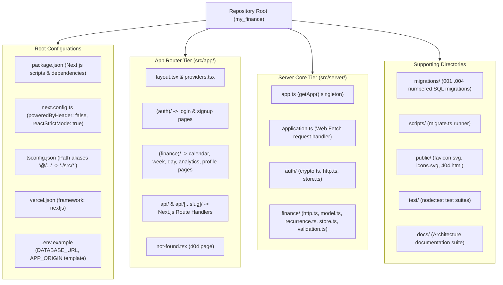
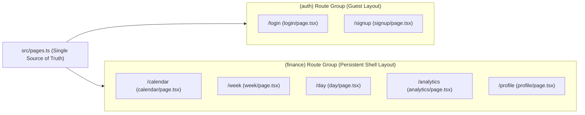

# 05. Project Structure

This document provides a complete reference of the **MyFinance** repository layout, Next.js App Router organization, source modules, database migrations, and test suites.

---

## 1. Project Topology

**MyFinance** is organized as a unified **Next.js 15 (App Router)** application at the repository root, consolidating frontend UI components and backend serverless route handlers into a single TypeScript package.



---

## 2. Annotated Directory Tree

```text
my_finance/
├── package.json                        # Scripts (dev, build, start, lint, test, db:migrate) & dependencies
├── next.config.ts                      # Next.js configuration (reactStrictMode, poweredByHeader)
├── tsconfig.json                       # TypeScript compiler options & '@/...' path alias mapping
├── vercel.json                         # Vercel deployment specification (framework: nextjs)
├── .env.example                        # Template for DATABASE_URL and APP_ORIGIN
├── AUTH.md                             # Authentication specification & security model
├── FINANCE.md                          # Finance persistence, API contract & recurrence specification
├── PAGES.md                            # Next.js App Router page manifest & deployment guide
├── public/                             # Static public assets served at root
│   ├── favicon.svg                     # App brand icon
│   ├── icons.svg                       # SVG sprite symbols
│   ├── 404.html                        # Standalone static 404 error page fallback
│   └── docs/                           # Pre-built architecture documentation viewer (/docs)
│       ├── index.html                  # Overview document viewer (/docs/index.html)
│       ├── 01..07-*.html               # Architecture chapter viewers
│       └── assets/                     # Stylesheet (style.css) & client renderer (app.js)
├── migrations/                         # Rerunnable numbered PostgreSQL DDL migrations
│   ├── 001_auth.sql                    # auth_users, auth_sessions, auth_refresh_tokens, auth_login_limits
│   ├── 002_finance.sql                 # finance_settings, finance_spendings
│   ├── 003_month_income.sql            # finance_income_entries (month-specific bonus income)
│   └── 004_repeat_spendings.sql        # finance_repeat_rules + finance_spendings.repeat_rule_id
├── scripts/
│   └── migrate.ts                      # CLI migration runner (executes migrations/*.sql in transactions)
├── docs/                               # Comprehensive Architecture Documentation Suite
│   ├── README.md                       # Architecture documentation index
│   ├── 01-system-architecture.md       # System context, container/component & ERD diagrams
│   ├── 02-deployment-architecture.md   # Vercel Next.js deployment & environment topology
│   ├── 03-cicd-architecture.md         # Build, test tiers, migration & release pipelines
│   ├── 04-source-code-architecture.md  # Frontend App Router & backend internal module design
│   ├── 05-project-structure.md         # Repository tree & file-by-file reference
│   ├── 06-use-case-diagrams.md         # Actor & functional use case diagrams
│   ├── 07-sequence-diagrams.md         # Runtime sequence diagrams
│   └── html/                           # Standalone browser HTML documentation viewer
│       ├── build.mjs                   # HTML generation script (node docs/html/build.mjs)
│       ├── index.html                  # Generated HTML viewer for README.md
│       ├── 01..07-*.html               # Generated HTML viewers for each chapter
│       └── assets/                     # Stylesheet (style.css) & client renderer (app.js)
├── src/
│   ├── app/                            # Next.js 15 App Router directory
│   │   ├── layout.tsx                  # Root layout: theme init script, noscript warning, providers
│   │   ├── providers.tsx               # Client component mounting ThemeProvider and AuthProvider
│   │   ├── page.tsx                    # Root index (/) redirecting to /calendar or /login
│   │   ├── not-found.tsx               # Next.js 404 Not Found error view
│   │   ├── (auth)/                     # Public authentication route group
│   │   │   ├── layout.tsx              # Auth layout redirecting authenticated visitors
│   │   │   ├── login/page.tsx          # Login view (/login)
│   │   │   └── signup/page.tsx         # Account registration view (/signup)
│   │   ├── (finance)/                  # Authenticated financial route group (Persistent Shell)
│   │   │   ├── layout.tsx              # Persistent shell: auth check, FinanceProvider, nav bar, modals
│   │   │   ├── calendar/page.tsx       # Monthly calendar & spending heatmap view (/calendar)
│   │   │   ├── week/page.tsx           # 7-day weekly breakdown view (/week)
│   │   │   ├── day/page.tsx            # Single-day transaction details view (/day)
│   │   │   ├── analytics/page.tsx      # Statistical analytics & forecasting view (/analytics)
│   │   │   └── profile/page.tsx        # Profile, categories, income & repeat rules view (/profile)
│   │   └── api/                        # Next.js Route Handlers
│   │       ├── route.ts                # Root API handler (health check /api)
│   │       └── [...slug]/route.ts      # Catch-all dynamic Route Handler for /api/v1/*
│   ├── components/                     # React UI components
│   │   ├── AuthScreen.tsx              # Login and signup form view (+ AuthScreen.css)
│   │   ├── CalendarView.tsx            # Monthly calendar grid with heatmap cards (+ CalendarView.css)
│   │   ├── WeekView.tsx                # Mobile-optimized 7-card weekly breakdown (+ WeekView.css)
│   │   ├── DayDetails.tsx              # Single-day transaction list with edit/delete actions
│   │   ├── AnalyticsView.tsx           # Statistical dashboard, KPI cards, and charts
│   │   ├── charts.tsx                  # Custom SVG charts (Forecast fan, Pareto, Punch card, Donut)
│   │   ├── ExpenseModal.tsx            # Create/edit single spending & repeat rule (+ ExpenseForm.css)
│   │   ├── MonthlyIncomeModal.tsx      # Shortcut modal to manage a specific month's bonus income
│   │   ├── MonthlyIncomeEntries.tsx    # Reusable monthly bonus income list & editor
│   │   ├── UserProfile.tsx             # Profile page sections & repeat rule manager (+ UserProfile.css)
│   │   ├── ProfileSection.tsx          # Collapsible editor card for profile sections
│   │   └── FinancePageViews.tsx        # Client view wrappers for App Router pages
│   ├── contexts/                       # React Context providers
│   │   ├── ThemeContext.tsx            # Theme provider (system preference + localStorage 'tracker_theme')
│   │   ├── AuthContext.tsx             # Auth state provider wrapping src/auth.ts
│   │   ├── FinanceShellContext.tsx     # Persistent shell state (active modal, current date query)
│   │   ├── FinanceContext.tsx          # Serialized CRUD & reload queue for finance data
│   │   └── SettingsContext.tsx         # Unified view of profile, theme, and financial settings
│   ├── server/                         # Backend domain engine
│   │   ├── app.ts                      # Singleton getter (getApp()) and fetch/listen delegation
│   │   ├── application.ts              # Web Request/Response pipeline (CORS, origin CSRF, body limits)
│   │   ├── config.ts                   # Environment variable parser and validator
│   │   ├── service-error.ts            # PostgreSQL/network error code diagnostic mapper
│   │   ├── auth/                       # Authentication subsystem
│   │   │   ├── crypto.ts               # scrypt password hashing, timing-safe equality, token primitives
│   │   │   ├── http.ts                 # /api/v1/auth request handler and requireAuth validator
│   │   │   └── store.ts                # AuthStore interface & Neon SQL implementation
│   │   └── finance/                    # Finance subsystem
│   │       ├── model.ts                # Domain types (FinanceSettings, Spending, RepeatRule)
│   │       ├── validation.ts           # Strict allowlist body and query validators
│   │       ├── recurrence.ts           # 14-day horizon check & bounded batch occurrence generator
│   │       ├── http.ts                 # /api/v1/finance request handler (settings, spendings, rules)
│   │       └── store.ts                # FinanceStore interface & Neon transactional implementation
│   ├── pages.ts                        # Page manifest: paths, titles, and protection metadata
│   ├── navigation.ts                   # Query string builders (?date=) and safe redirect validation
│   ├── auth.ts                         # In-memory token store, Web Locks API, BroadcastChannel
│   ├── finance.ts                      # Typed /api/v1/finance client with cursor traversal
│   ├── types.ts                        # Shared frontend TypeScript interfaces
│   ├── spendings.ts                    # Date filtering, daily totals & compact VND currency formatting
│   ├── income.ts                       # Effective monthly income calculator (base + bonus entries)
│   ├── heatmap.ts                      # Relative spending intensity RGBA scaling
│   ├── analytics.ts                    # Statistical engine (OLS forecast, Tukey outliers, Gini, Pareto)
│   ├── expenseDraft.ts                 # Dirty-state detection for the ExpenseModal form
│   ├── expenseBatch.ts                 # Helper for repeat expense and multi-item creation
│   ├── incomeEntryDraft.ts             # Dirty-state detection for monthly bonus income forms
│   ├── useUnsavedChanges.ts            # Browser beforeunload and navigation confirmation guards
│   ├── mockData.ts                     # Default category definitions and fallback constants
│   ├── index.css                       # Global design tokens, CSS variables, glassmorphism styles
│   ├── App.css                         # Application layout styles
│   └── navigation.css                  # Document header and navigation bar styles
└── test/                               # Automated test suites (node:test + tsx)
    ├── pages.test.ts                   # Validates App Router files, titles, and vercel.json alignment
    ├── navigation.test.ts              # Date query parsing and open-redirect prevention
    ├── auth.test.ts                    # Web Locks, BroadcastChannel, and session lifecycle
    ├── finance.test.ts                 # Cursor pagination, loop protection, and finance CRUD
    ├── income-api.test.ts              # Monthly bonus income API endpoint tests
    ├── spendings.test.ts               # Daily totals and currency formatting tests
    ├── income.test.ts                  # Effective monthly income calculations
    ├── heatmap.test.ts                 # Heatmap RGBA intensity scaling tests
    ├── expense-batch.test.ts           # Batch expense submission tests
    ├── expense-draft.test.ts           # Expense modal dirty-draft guard tests
    ├── income-entry-draft.test.ts      # Income entry dirty-draft guard tests
    ├── calendar-scroll.test.ts         # Calendar view scroll behavior tests
    ├── crypto.test.ts                  # Password KDF and token primitive tests
    ├── http.test.ts                    # Auth HTTP contract, CSRF, and rate limit tests
    ├── finance-http.test.ts            # Finance HTTP CRUD, pagination, and category validation
    ├── recurrence.test.ts              # Recurrence batch generation tests
    ├── service-error.test.ts           # Error sanitization and diagnostic mapping tests
    ├── neon.test.ts                    # (Integration) Real Neon DB concurrent refresh & rate limits
    └── finance-neon.test.ts            # (Integration) Real Neon DB category-lock race tests
```

---

## 3. Next.js App Router Page Manifest Mapping

The single source of truth for all application routes is [`src/pages.ts`](../src/pages.ts). Every defined page corresponds directly to a Next.js App Router segment:

| Page ID | Public Path | App Router Segment | Route Group | Protected | Title |
| :--- | :--- | :--- | :--- | :--- | :--- |
| `home` | `/` | `src/app/page.tsx` | Root | No | `MyFinance` |
| `login` | `/login` | `src/app/(auth)/login/page.tsx` | `(auth)` | No | `Sign in · MyFinance` |
| `signup` | `/signup` | `src/app/(auth)/signup/page.tsx` | `(auth)` | No | `Create account · MyFinance` |
| `calendar` | `/calendar` | `src/app/(finance)/calendar/page.tsx` | `(finance)` | Yes | `Calendar · MyFinance` |
| `week` | `/week` | `src/app/(finance)/week/page.tsx` | `(finance)` | Yes | `Week · MyFinance` |
| `day` | `/day` | `src/app/(finance)/day/page.tsx` | `(finance)` | Yes | `Day details · MyFinance` |
| `analytics` | `/analytics` | `src/app/(finance)/analytics/page.tsx` | `(finance)` | Yes | `Analytics · MyFinance` |
| `profile` | `/profile` | `src/app/(finance)/profile/page.tsx` | `(finance)` | Yes | `Profile · MyFinance` |


