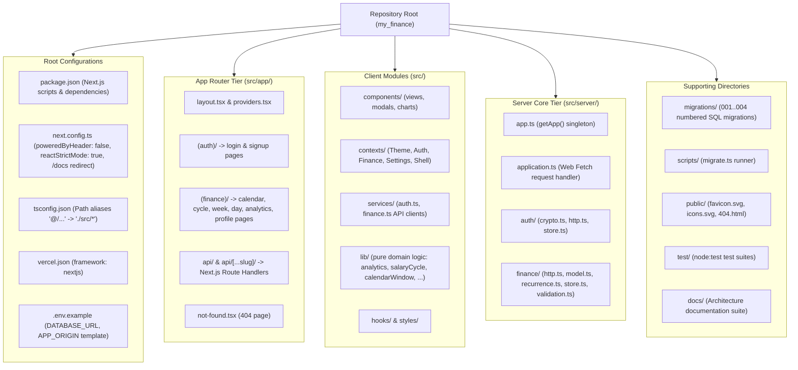
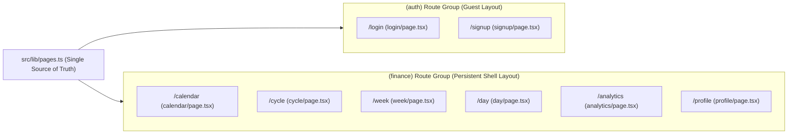

# 05. Project Structure

This document provides a complete reference of the **MyFinance** repository layout, Next.js App Router organization, source modules, database migrations, and test suites.

---

## 1. Project Topology

**MyFinance** is organized as a unified **Next.js 15 (App Router)** application at the repository root, consolidating frontend UI components and backend serverless route handlers into a single TypeScript package.



---

## 2. Annotated Directory Tree

```text
my_finance/
├── package.json                        # Scripts (dev, build, docs:build, start, lint, test, db:migrate) & dependencies
├── next.config.ts                      # Next.js config (reactStrictMode, poweredByHeader: false, /docs redirect)
├── tsconfig.json                       # TypeScript compiler options & '@/...' path alias mapping
├── vercel.json                         # Vercel deployment specification (framework: nextjs)
├── .env.example                        # Template for DATABASE_URL and APP_ORIGIN (+ optional test DB URLs)
├── AUTH.md                             # Authentication API contract & security model
├── FINANCE.md                          # Finance persistence, API contract & recurrence specification
├── PAGES.md                            # Next.js App Router page manifest & local run guide
├── public/                             # Static public assets served at root
│   ├── favicon.svg                     # App brand icon
│   ├── icons.svg                       # SVG sprite symbols
│   ├── 404.html                        # Standalone static 404 page (legacy; Next.js uses not-found.tsx)
│   └── docs/                           # Generated architecture documentation (served at /docs)
│       ├── index.html, 01..07-*.html   # Generated by docs/html/build.mjs
│       └── assets/                     # Stylesheet (style.css) & client renderer (app.js)
├── migrations/                         # Rerunnable numbered PostgreSQL DDL migrations
│   ├── 001_auth.sql                    # auth_users, auth_sessions, auth_refresh_tokens, auth_login_limits
│   ├── 002_finance.sql                 # finance_settings, finance_spendings
│   ├── 003_month_income.sql            # finance_income_entries (month-specific additional income)
│   └── 004_repeat_spendings.sql        # finance_repeat_rules + finance_spendings.repeat_rule_id
├── scripts/
│   └── migrate.ts                      # CLI migration runner (executes migrations/*.sql in transactions)
├── docs/                               # Architecture documentation suite (Markdown source)
│   ├── README.md                       # Documentation index & architectural highlights
│   ├── 01..07-*.md                     # System, deployment, CI/CD, source, structure, use cases, sequences
│   └── html/                           # Generated HTML viewer
│       ├── build.mjs                   # Generator (npm run docs:build; also runs in npm run build)
│       ├── index.html, 01..07-*.html   # Generated pages (copied to public/docs/)
│       └── assets/                     # Stylesheet (style.css) & client renderer (app.js)
├── src/
│   ├── types.ts                        # Shared frontend types (Spending, RepeatRule, IncomeEntry, UserSettings, ...)
│   ├── app/                            # Next.js 15 App Router directory
│   │   ├── layout.tsx                  # Root layout: theme init script, noscript notice, global CSS, providers
│   │   ├── providers.tsx               # Client component mounting ThemeProvider and AuthProvider
│   │   ├── page.tsx                    # Root index (/) redirecting to /calendar or /login
│   │   ├── not-found.tsx               # Next.js 404 Not Found view
│   │   ├── (auth)/                     # Public authentication route group
│   │   │   ├── layout.tsx              # Redirects authenticated visitors to ?next= or /calendar
│   │   │   ├── login/page.tsx          # Login view (/login)
│   │   │   └── signup/page.tsx         # Registration view (/signup)
│   │   ├── (finance)/                  # Authenticated route group (persistent shell)
│   │   │   ├── layout.tsx              # Auth guard, FinanceProvider, FinanceGate, header nav, shared modals
│   │   │   ├── calendar/page.tsx       # Scrollable calendar & spending heatmap (/calendar)
│   │   │   ├── cycle/page.tsx          # Salary (pay) cycle view (/cycle)
│   │   │   ├── week/page.tsx           # 7-day weekly breakdown (/week)
│   │   │   ├── day/page.tsx            # Single-day transactions (/day)
│   │   │   ├── analytics/page.tsx      # Statistical analytics & forecasting (/analytics)
│   │   │   └── profile/page.tsx        # Profile, income, categories, avatar, theme & repeat rules (/profile)
│   │   └── api/                        # Next.js Route Handlers (GET/HEAD/POST/PUT/DELETE/OPTIONS -> app.fetch)
│   │       ├── route.ts                # /api (health response)
│   │       └── [...slug]/route.ts      # Catch-all for /api/v1/*
│   ├── components/                     # React UI components
│   │   ├── AuthScreen.tsx              # Login and signup form
│   │   ├── CalendarView.tsx            # Scroll-driven week grid with heatmap & progressive reveal
│   │   ├── SalaryCycleView.tsx         # Pay cycle grid, payday/delay pickers, cycle totals
│   │   ├── WeekView.tsx                # Mobile-optimized 7-card weekly breakdown
│   │   ├── DayDetails.tsx              # Single-day transaction list with edit/delete actions
│   │   ├── AnalyticsView.tsx           # Statistical dashboard, KPI cards, and charts
│   │   ├── charts.tsx                  # Custom SVG charts (forecast fan, Pareto, punch card, donut)
│   │   ├── ExpenseModal.tsx            # Create/edit single spending & repeat rule
│   │   ├── MonthlyIncomeModal.tsx      # Shortcut modal for one month's additional income
│   │   ├── MonthlyIncomeEntries.tsx    # Reusable additional-income list & editor
│   │   ├── UserProfile.tsx             # Profile page sections & repeat rule manager
│   │   ├── ProfileSection.tsx          # Collapsible editor card for profile sections
│   │   └── FinancePageViews.tsx        # Client view wrappers connecting pages to FinanceShellContext
│   ├── contexts/                       # React Context providers
│   │   ├── ThemeContext.tsx            # Theme (system preference + localStorage 'tracker_theme')
│   │   ├── AuthContext.tsx             # Auth state provider wrapping services/auth.ts
│   │   ├── FinanceShellContext.tsx     # Shell state: current/active date, open date, open modals
│   │   ├── FinanceContext.tsx          # Serialized CRUD/reload queue + date-range spending loader
│   │   └── SettingsContext.tsx         # Unified view of profile, theme, and financial settings
│   ├── services/                       # Browser API clients
│   │   ├── auth.ts                     # In-memory token store, Web Locks, BroadcastChannel, authenticatedFetch
│   │   └── finance.ts                  # Typed /api/v1/finance client (cursor traversal, date ranges)
│   ├── lib/                            # Pure domain logic & utilities
│   │   ├── pages.ts                    # Page manifest: paths, titles, protection metadata
│   │   ├── navigation.ts               # Query string builders (?date=) and safe redirect validation
│   │   ├── spendings.ts                # Date filtering, daily totals & compact VND formatting
│   │   ├── income.ts                   # Effective monthly income (recurring + additional entries)
│   │   ├── heatmap.ts                  # Relative spending intensity RGBA scaling
│   │   ├── analytics.ts                # Statistical engine (OLS forecast, Tukey outliers, Gini, Pareto)
│   │   ├── salaryCycle.ts              # Payday, weekend shift, month delays, cycle ranges, localStorage config
│   │   ├── calendarWindow.ts           # Calendar month range & scroll-driven week fetch batching
│   │   ├── expenseDraft.ts             # Dirty-state detection for the ExpenseModal form
│   │   ├── expenseBatch.ts             # Repeat expense / multi-item creation helper
│   │   └── incomeEntryDraft.ts         # Dirty-state detection for additional-income forms
│   ├── hooks/
│   │   └── useUnsavedChanges.ts        # beforeunload and in-app navigation confirmation guards
│   ├── styles/                         # Global and component CSS
│   │   ├── globals.css                 # Design tokens, CSS variables, glassmorphism styles
│   │   ├── navigation.css              # Document header and navigation bar
│   │   └── AuthScreen, CalendarView, SalaryCycleView, WeekView, ExpenseForm, MonthlyIncomeModal, UserProfile .css
│   └── server/                         # Backend domain engine
│       ├── app.ts                      # Lazy singleton (getApp()) wiring Neon stores; fetch/listen delegation
│       ├── application.ts              # Web Request/Response pipeline (CORS, origin check, body limits, routing)
│       ├── config.ts                   # .env loading, environment parsing & validation
│       ├── service-error.ts            # PostgreSQL/network error -> safe diagnostic mapper
│       ├── auth/
│       │   ├── crypto.ts               # scrypt hashing, timing-safe compare, token primitives
│       │   ├── http.ts                 # /api/v1/auth handler, authenticateRequest, HttpError
│       │   └── store.ts                # AuthStore interface & Neon SQL implementation
│       └── finance/
│           ├── model.ts                # Domain types, default categories, allowed icons
│           ├── validation.ts           # Strict allowlist body and query validators
│           ├── recurrence.ts           # 14-day horizon check & bounded batch occurrence generator
│           ├── http.ts                 # /api/v1/finance handler (settings, spendings, income, rules)
│           └── store.ts                # FinanceStore interface & Neon transactional implementation
└── test/                               # node:test + tsx suites
    ├── pages.test.ts                   # App Router files, titles, vercel.json alignment
    ├── navigation.test.ts              # Date query parsing and open-redirect prevention
    ├── auth.test.ts                    # Web Locks, BroadcastChannel, session lifecycle
    ├── finance.test.ts                 # Cursor pagination, loop protection, finance CRUD client
    ├── income-api.test.ts              # Additional income client/API tests
    ├── spendings.test.ts               # Daily totals and currency formatting
    ├── income.test.ts                  # Effective monthly income calculations
    ├── heatmap.test.ts                 # Heatmap intensity scaling
    ├── expense-batch.test.ts           # Batch expense submission
    ├── expense-draft.test.ts           # Expense modal dirty-draft guard
    ├── income-entry-draft.test.ts      # Income entry dirty-draft guard
    ├── calendar-scroll.test.ts         # Calendar window & week fetch batching
    ├── salary-cycle.test.ts            # Salary cycle payday/range calculations
    ├── crypto.test.ts                  # Password KDF and token primitives
    ├── http.test.ts                    # Auth HTTP contract, CSRF, rate limit
    ├── finance-http.test.ts            # Finance HTTP CRUD, pagination, category validation
    ├── recurrence.test.ts              # Recurrence batch generation
    ├── service-error.test.ts           # Error sanitization
    ├── neon.test.ts                    # (Integration, opt-in) real Neon auth concurrency
    └── finance-neon.test.ts            # (Integration, opt-in) real Neon category-lock race
```

---

## 3. Next.js App Router Page Manifest Mapping

The single source of truth for all application routes is [`src/lib/pages.ts`](../src/lib/pages.ts). Every defined page corresponds directly to a Next.js App Router segment:

| Page ID | Public Path | App Router Segment | Route Group | Protected | Title |
| :--- | :--- | :--- | :--- | :--- | :--- |
| `home` | `/` | `src/app/page.tsx` | Root | No | `MyFinance` |
| `login` | `/login` | `src/app/(auth)/login/page.tsx` | `(auth)` | No | `Sign in · MyFinance` |
| `signup` | `/signup` | `src/app/(auth)/signup/page.tsx` | `(auth)` | No | `Create account · MyFinance` |
| `calendar` | `/calendar` | `src/app/(finance)/calendar/page.tsx` | `(finance)` | Yes | `Calendar · MyFinance` |
| `cycle` | `/cycle` | `src/app/(finance)/cycle/page.tsx` | `(finance)` | Yes | `Salary Cycle · MyFinance` |
| `week` | `/week` | `src/app/(finance)/week/page.tsx` | `(finance)` | Yes | `Week · MyFinance` |
| `day` | `/day` | `src/app/(finance)/day/page.tsx` | `(finance)` | Yes | `Day details · MyFinance` |
| `analytics` | `/analytics` | `src/app/(finance)/analytics/page.tsx` | `(finance)` | Yes | `Analytics · MyFinance` |
| `profile` | `/profile` | `src/app/(finance)/profile/page.tsx` | `(finance)` | Yes | `Profile · MyFinance` |


