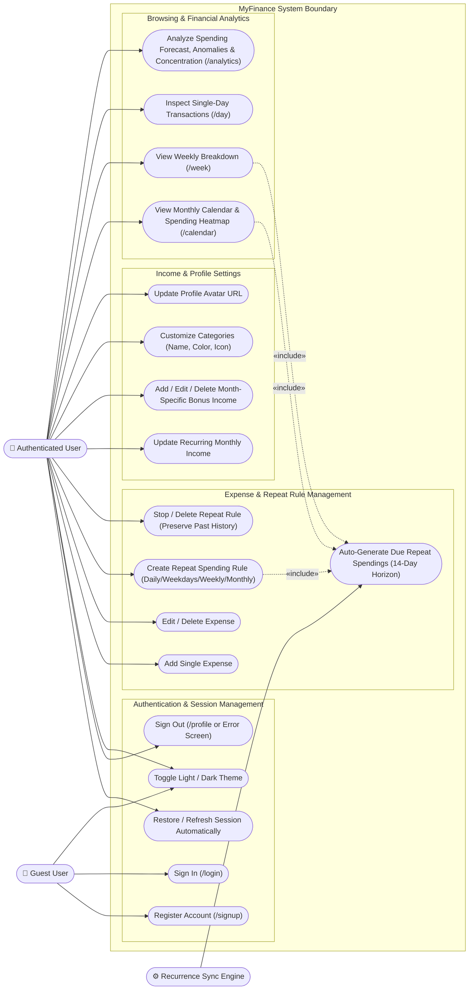
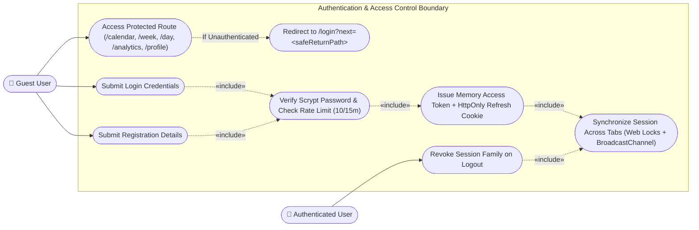
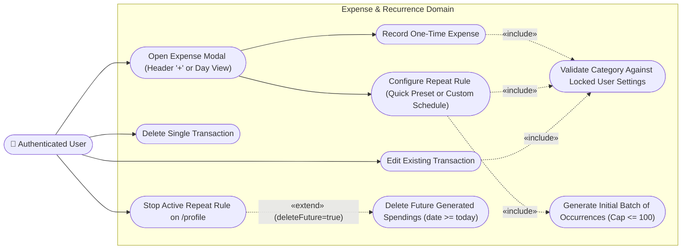
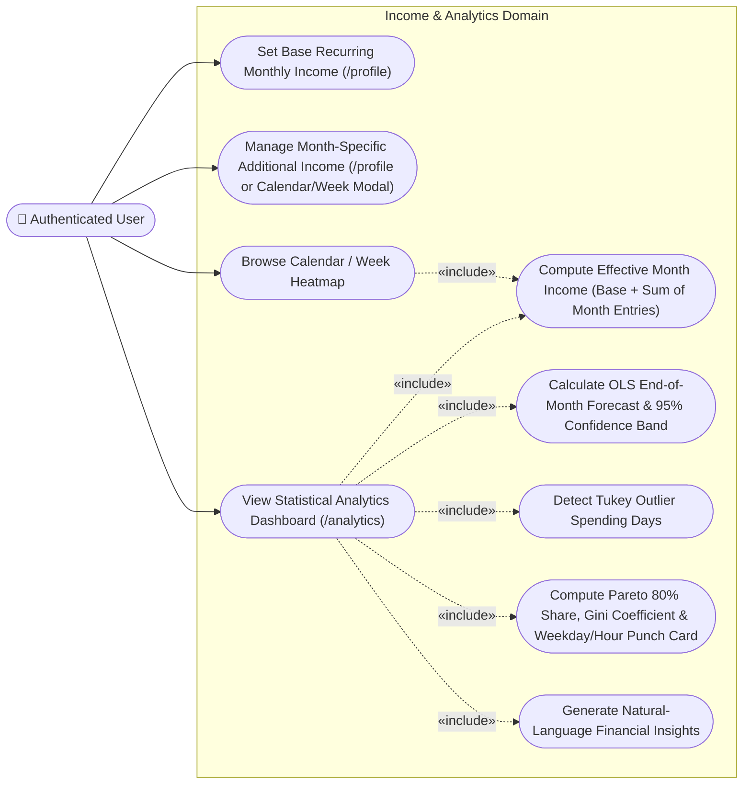

# 06. System Use Case Diagrams

This document illustrates the functional capabilities of **MyFinance** through Use Case diagrams and actor specifications across all system domains.

---

## 1. Actors Overview

| Actor | Type | Description |
| :--- | :--- | :--- |
| **Guest (Unauthenticated User)** | Primary Human Actor | A visitor who has not yet signed in. Can register a new account, sign in with email and password, or toggle the local light/dark appearance theme. |
| **Authenticated User** | Primary Human Actor | A signed-in user managing their personal finances across Calendar, Week, Day, Analytics, and Profile views. |
| **Recurrence Sync Engine** | Internal System Actor | Automated backend subsystem (`syncRepeatSpendings`) triggered during data loads or explicit sync calls to materialize upcoming recurring expenses within a 14-day lookahead horizon. |

---

## 2. Overall System Use Case Diagram

---

## 3. Domain-Specific Use Case Breakdowns

### 3.1 Authentication & Multi-Tab Session Use Cases

### 3.2 Expense Tracking & Recurring Rule Use Cases

### 3.3 Income Management & Financial Analytics Use Cases

---

## 4. Use Case Specifications Summary

| ID | Use Case Name | Primary Actor | Entry Point / Endpoint | Key Business Rules & Postconditions |
| :--- | :--- | :--- | :--- | :--- |
| **UC-01** | **Register Account** | Guest | `/signup` → `POST /api/v1/auth/register` | Validates name (1–100 chars), normalized email ($\le 254$ chars), and password (12–128 chars). Reserves rate-limit slot (`10/15m`), hashes password with `scrypt`, creates user + session + refresh token history in one SQL CTE. |
| **UC-02** | **Sign In** | Guest | `/login` → `POST /api/v1/auth/login` | Reserves rate-limit slot, performs constant-time `scrypt` verification (or dummy KDF if email unknown), sets `mf_refresh` cookie, returns 15m `accessToken`, redirects to `safeReturnPath(next)`. |
| **UC-06** | **Add Single Expense** | Authenticated User | `ExpenseModal` → `POST /api/v1/finance/spendings` | Locks `finance_settings` row (`FOR UPDATE`), verifies category exists in user's active categories, inserts UUID spending with exact decimal amount ($>0 \dots 10^{12}$), `YYYY-MM-DD` date, and `HH:mm` time. |
| **UC-08** | **Create Repeat Rule** | Authenticated User | `ExpenseModal` → `POST /api/v1/finance/repeat-rules` | Validates frequency (`daily`, `weekdays`, `weekly`, `monthly`) and end condition (`unlimited`, `occurrences` $\le 100$, `until_date`). Inserts rule and bulk-inserts initial batch of up to 100 occurrences in a single transaction. |
| **UC-09** | **Stop Repeat Rule** | Authenticated User | `/profile` → `DELETE /api/v1/finance/repeat-rules/:id?deleteFuture=true` | Deletes future generated spendings (`date >= today`) and deletes the rule row; historical past spendings remain intact with `repeat_rule_id = NULL`. |
| **UC-12** | **Manage Monthly Bonus Income** | Authenticated User | `/profile` or `MonthlyIncomeModal` → `POST/PUT/DELETE /api/v1/finance/income-entries` | Stores non-recurring bonus/extra income scoped to a specific `YYYY-MM` month. Effective monthly income is `settings.income + sum(entries for YYYY-MM)`. |
| **UC-18** | **View Analytics & Forecast** | Authenticated User | `/analytics` (`computeMonthlyAnalytics`) | Computes daily series, 7-day moving average, OLS cumulative projection with $95\%$ confidence interval, Tukey outlier days, category MoM changes, $7 \times 24$ punch card, Pareto curve, Gini index, and actionable text insights. |
