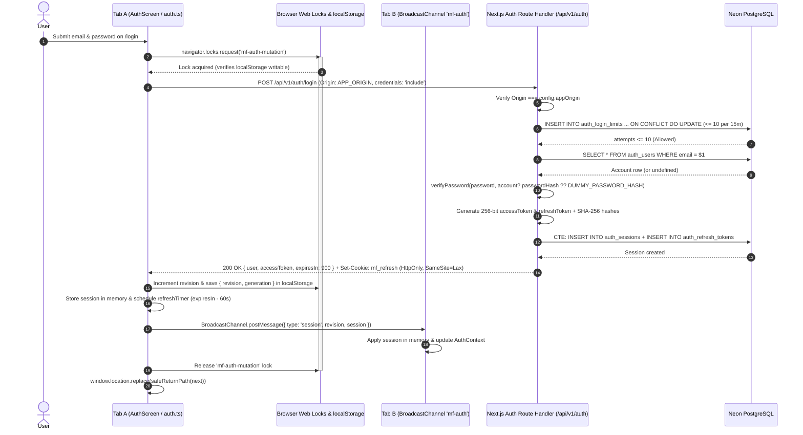
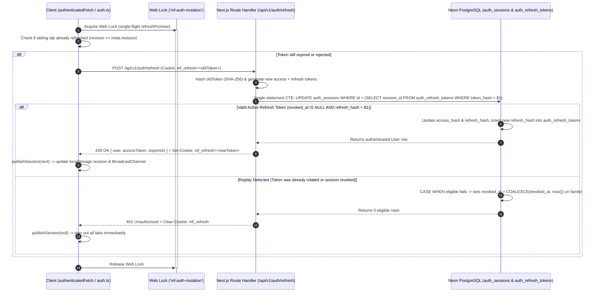
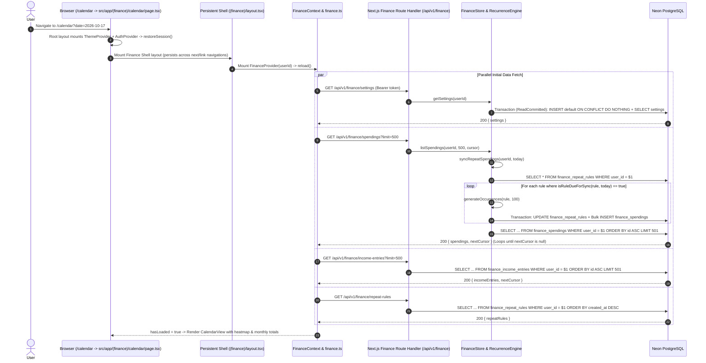
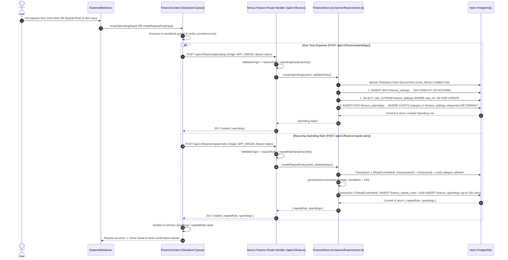
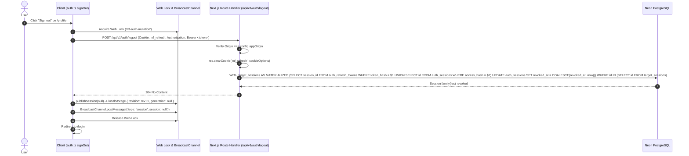

# 07. Sequence Diagrams

This document captures the detailed runtime interaction sequences of **MyFinance** across browser tabs, React contexts, Next.js Route Handlers, and Neon PostgreSQL transactions.

---

## 1. User Sign-In & Cross-Tab Session Broadcast

When a user signs in on `/login`, the client coordinates session state across tabs using the **Web Locks API** and **BroadcastChannel**, while the Next.js Route Handler enforces rate limiting, constant-time `scrypt` verification, and `HttpOnly` refresh cookie issuance.

---

## 2. Single-Flight Token Rotation & Replay Detection

When an access token is within 60 seconds of expiry, when a page reloads (`restoreSession`), or when a protected API request receives `401 Unauthorized`, the client performs a lock-serialized refresh rotation. If a consumed refresh token is replayed, PostgreSQL atomically revokes the entire session family.

---

## 3. Protected Page Load, Initial Fetch & Horizon Auto-Sync

When an authenticated user loads a protected page (e.g., `/calendar`), Next.js mounts the persistent `(finance)` layout shell (`src/app/(finance)/layout.tsx`), which keeps `FinanceProvider` and navigation mounted. The provider loads settings, paginated spendings, paginated income entries, and repeat rules in parallel. The backend automatically evaluates and syncs recurring rules within the 14-day horizon before returning spendings.

---

## 4. Creating an Expense or Repeat Rule with Per-User Row Locking

To prevent race conditions between category edits and expense creation, all expense and repeat-rule writes serialize on the user's `finance_settings` row using `SELECT ... FOR UPDATE` inside a `ReadCommitted` transaction.

---

## 5. User Logout & Materialized Session Family Revocation

When a user signs out, the Next.js Route Handler clears the `mf_refresh` cookie first and revokes both the refresh cookie's session family and the bearer token's session family using a `MATERIALIZED` CTE snapshot so concurrent token rotations cannot evade revocation.

