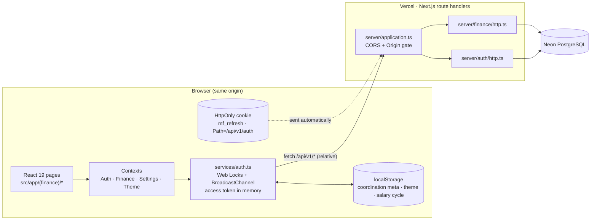
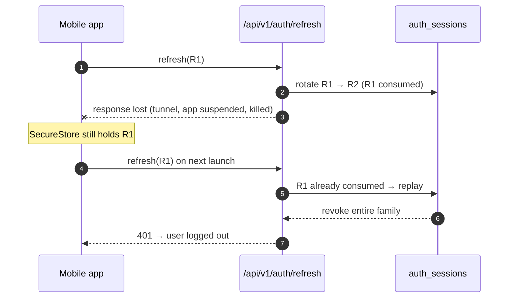
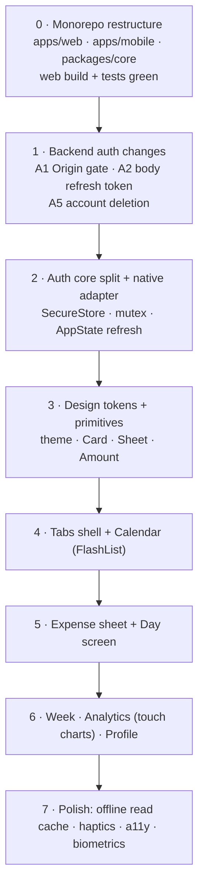

# 08. Mobile Port Analysis (Web → Expo)

This document analyses what breaks, what must be redesigned, and what can be reused when porting MyFinance from the Next.js web app to an **Expo (React Native) mobile app**. It covers two areas in depth: **authentication** and **UI/UX**. Every finding points at the current source so it can be verified and tracked.

> **Scope.** Analysis only; no code has changed. The target is Expo SDK with the React Native New Architecture, Hermes, `expo-router`, and a monorepo layout (`apps/web`, `apps/mobile`, `packages/core`). The backend (`src/server/*`, served by Vercel) stays as the single API for both clients.

---

## 1. Summary

| # | Area | Finding | Severity |
| :--- | :--- | :--- | :--- |
| A1 | Auth | Origin gate rejects every mobile write request with **403** | **Blocker** |
| A2 | Auth | Refresh token travels **only** as an `HttpOnly` cookie | **Blocker** |
| A3 | Auth | No persistent credential → user must log in on every cold start | **Blocker** |
| A4 | Auth | `src/services/auth.ts` depends on browser-only APIs | **Blocker** |
| A5 | Auth | iOS App Store requires in-app account deletion; no endpoint exists | **Blocker (iOS release)** |
| A6 | Auth | Refresh rotation + replay detection is fragile on flaky mobile networks | High |
| A7 | Auth | App lifecycle (background/suspend) invalidates the refresh timer model | High |
| A8 | Auth | Dev networking: `localhost`, HTTP and emulator address differences | Medium |
| A9 | Auth | Credential entry UX: 12+ char passwords, autofill, biometrics | Medium |
| A10 | Auth | Logout, local sign-out and deep-link return paths | Medium |
| U1 | UI | DOM + ~3,400 lines of CSS have no React Native equivalent | **Blocker (rewrite)** |
| U2 | UI | Calendar scroll engine is built on DOM measurement | **High (rebuild)** |
| U3 | UI | Charts are hand-drawn SVG with mouse-hover tooltips | **High (rebuild)** |
| U4 | UI | Expense modal uses HTML form inputs, portal and combobox | High |
| U5 | UI | Analytics dashboard is a desktop multi-column grid | High |
| U6 | UI | Navigation shell, URL state and global modals | Medium |
| U7 | UI | Unsaved-changes guard uses `beforeunload` / `window.confirm` | Medium |
| U8 | UI | Profile: 7 tabs, URL-only avatar, clipboard | Medium |
| U9 | UI | Theme initialisation is DOM-based | Low |
| U10 | UI | Data freshness tied to `window` focus and `pageshow` | Medium |
| U11 | UI | "Shared" `src/lib` is not fully platform-neutral | Medium |
| U12 | UI | Platform conventions: safe areas, gestures, haptics, a11y, offline | Medium |

**Code volume affected.** UI components total ~5,130 lines (`src/components/*.tsx`) and styles ~3,440 lines (`src/styles/*.css`). Both are rewritten for mobile. Business logic in `src/lib/*.ts` (~all pure TypeScript), `src/types.ts`, and the request shapes in `src/services/finance.ts` are reusable.

---

## 2. Current Architecture (what the port starts from)



Key properties of the web design that the mobile app cannot inherit as-is:

- **Same-origin everything.** UI and API share one origin; requests use relative URLs (`/api/v1/auth/...`), and the server trusts the `Origin` header as its CSRF defence.
- **Cookie-held refresh token.** The 30-day refresh token (`REFRESH_SECONDS`, `src/server/auth/crypto.ts:6`) is never visible to JavaScript.
- **Memory-only access token.** The 15-minute access token (`ACCESS_SECONDS`, `crypto.ts:5`) lives in a module variable and is restored after reload via the cookie.
- **Multi-tab coordination.** Web Locks serialise refresh across tabs; BroadcastChannel shares the new session.

---

## 3. Authentication Analysis

### A1 — Origin gate rejects mobile writes (Blocker)

**Where:** `src/server/application.ts:71`

```ts
if (!isMcpRoute && !["GET", "HEAD", "OPTIONS"].includes(method)
    && request.headers.get("origin") !== config.appOrigin) {
  return sendJson(403, { error: "Origin not allowed" }, ...);
}
```

**Problem.** React Native's `fetch` (native networking on iOS/Android) does not set an `Origin` header by default. `null !== config.appOrigin`, so **every** `POST`/`PUT`/`DELETE` from the app — including `/auth/login`, `/auth/register`, `/auth/refresh` and every finance write — returns 403. The app could read nothing either, because it could never log in.

**Why the gate exists.** It is a CSRF defence for cookie-based auth: a hostile site cannot make the browser send `mf_refresh` with a forged request. The MCP route is already exempt because it uses bearer/API-key auth, which is not ambient.

**Fix (recommended).** Only enforce the gate where an ambient credential could be abused:

| Request | Origin header | Cookie header | Decision |
| :--- | :--- | :--- | :--- |
| Web app | `appOrigin` | maybe | allow |
| Hostile site (browser) | other origin | maybe | **reject** — browsers always send `Origin` on cross-origin `POST`/`fetch` |
| Mobile app | absent | absent | allow — no ambient credential to abuse |
| Odd client | absent | **present** | **reject** — cookie without a verifiable origin |

i.e. reject when `origin !== appOrigin && (origin !== null || hasCookie)`. Add tests to `test/http.test.ts` for all four rows.

### A2 — Refresh token is cookie-only (Blocker)

**Where:** `src/server/auth/http.ts`

- `issue()` (line 112) puts the refresh token **only** in `Set-Cookie`; the JSON body is `{ user, accessToken, expiresIn }`.
- `/refresh` (line 169) and `/logout` (line 188) read the token **only** from the `Cookie` header via `refreshCookiesFromHeader`.
- The cookie is scoped `Path=/api/v1/auth`, `HttpOnly`, `SameSite=Lax`, `Secure` in production (`formatRefreshCookie`, line 85).

**Problem.** On native, cookies are stored by the OS networking stack (`NSHTTPCookieStorage` / OkHttp cookie jar), outside JavaScript's control:

- `HttpOnly` protects against XSS in a browser; it means nothing in a native app.
- Persistence, clearing and path matching behave differently on iOS vs Android, and are hard to clear deterministically on logout.
- The app cannot inspect the token, so it cannot store it in the Keychain/Keystore — the actual secure storage on mobile.

**Fix (recommended).** Add an explicit mobile transport, leaving the web flow untouched:

1. The client identifies itself, e.g. header `X-MF-Client: mobile` (it is a routing hint, not a security control).
2. For mobile requests, `issue()` returns `refreshToken` in the JSON body and sets **no** cookie.
3. `/refresh` and `/logout` accept `{ refreshToken }` in the body when no cookie is present. Reject a request that sends both.
4. Web responses never include `refreshToken` in the body (keeps XSS exposure unchanged).

Rotation, replay detection and the atomic CTE in `src/server/auth/store.ts:92-109` stay exactly as they are; only the transport changes.

### A3 — Sessions do not survive a cold start (Blocker)

**Problem.** The web app restores a session after reload by calling `/refresh` with the cookie (`restoreSession`, `src/services/auth.ts:166`). Mobile OSes kill backgrounded apps routinely; with a memory-only token and no cookie, the user would see the login screen on nearly every launch.

**Fix.**

| Credential | Web (today) | Mobile (proposed) |
| :--- | :--- | :--- |
| Access token (15 min) | memory | memory |
| Refresh token (30 days) | `HttpOnly` cookie | `expo-secure-store` (iOS Keychain / Android Keystore-backed), `keychainAccessible: AFTER_FIRST_UNLOCK` |
| Session metadata (user, generation) | localStorage coordination | MMKV or SecureStore |

Cold start: read refresh token → `/refresh` → store the **new** refresh token → enter app. Hold the splash screen (`expo-splash-screen`) until this resolves so the user never sees a login flash.

### A4 — `services/auth.ts` is browser-only (Blocker for reuse)

| Dependency | Where | Mobile status | Replacement |
| :--- | :--- | :--- | :--- |
| `BroadcastChannel` | `auth.ts:47` | not available | not needed (single process) |
| `navigator.locks` | `withAuthLock`, line 94 — **throws** if missing | not available | in-memory promise mutex |
| `localStorage` coordination | `coordination()`, line 49 | not available | not needed; persist session in SecureStore |
| Relative URLs `/api/v1/auth/...` | `request()`, line 106 | no origin to resolve against | configurable absolute `API_BASE_URL` |
| `window.location.origin` same-origin check | `authenticatedFetch`, line 213 | not available | check against `API_BASE_URL` |
| `credentials: 'include'`, `cache: 'no-store'` | `request()` | meaningless / ignored | drop; send refresh token in body (A2) |
| `crypto.randomUUID()` | lines 154, 187, 194 | not on Hermes by default | `expo-crypto` `randomUUID()` |

Because `withAuthLock` throws when Web Locks are missing, **sign-in would fail before any request is sent**.

**What carries over.** The single-flight refresh (`refreshPromise`), "retry once after 401" in `authenticatedFetch`, the 60-second early-refresh margin, the "generation" check that refuses to replay a request under a different login, and the rule *never blindly retry a rotation*. Recommended split:

```
packages/core/auth/
  session.ts        // platform-neutral state machine: single-flight refresh, generation, 401 retry
  types.ts          // AuthUser, AuthResponse, Session
apps/web/.../auth-web.ts      // Web Locks + BroadcastChannel + cookie transport
apps/mobile/.../auth-native.ts // promise mutex + SecureStore + body transport
```

`createFinanceApi(fetcher)` in `src/services/finance.ts` already takes an injectable fetcher, so the finance client ports unchanged once given a mobile `authenticatedFetch`.

### A5 — Account deletion required by Apple (Blocker for iOS release)

App Store Review Guideline 5.1.1(v) requires apps that let users create an account to let them **delete it from within the app**. The auth API (`src/server/auth/http.ts`) exposes `register`, `login`, `refresh`, `logout`, `me` and `api-keys` — there is no delete-account route, and no cascade for `finance_*` data. This needs a backend endpoint (re-authenticate with password, revoke all sessions and API keys, delete or anonymise finance rows) plus a Profile screen action, before the first iOS submission.

### A6 — Rotation and replay detection on flaky networks (High)

**Where:** `src/server/auth/store.ts:92-109`; client comment at `auth.ts:157` ("a lost response may have consumed the old token").

Each `/refresh` consumes the old refresh token and issues a new one. Reusing a consumed token is treated as theft and **revokes the whole session family**.



This is the same logic as on web, but mobile makes the lost-response case far more frequent (cell handover, background suspension mid-request, OS kill).

**Mitigations (choose deliberately):**

1. **Client discipline (required).** Write the new refresh token to SecureStore *before* anything else uses the response; never auto-retry a failed rotation; single-flight all refreshes.
2. **Fewer rotations.** Refresh only when needed (on resume or a 401) rather than on a fixed timer, to reduce exposure.
3. **Server grace window (optional, a security trade-off).** For a few seconds after rotation, accept the immediately previous token once and return the *same* new pair instead of revoking. Document the decision either way; if adopted, add Neon concurrency tests next to `test/finance-neon.test.ts`.

### A7 — App lifecycle vs. the refresh timer (High)

**Where:** `applySession` schedules `setTimeout(refresh, expiresAt - 60s)` (`auth.ts:65`).

On mobile, JS timers pause while the app is backgrounded. After resuming, the 15-minute access token is usually expired and several screens fire requests at once.

**Fix.** Drive refresh from `AppState` (`active`) and from the existing pre-request expiry check in `authenticatedFetch`. Keep the single-flight so a burst of resume requests produces exactly one `/refresh`. Optional: hide sensitive content in the app switcher snapshot when going to `inactive`.

### A8 — Development networking (Medium)

| Situation | Problem | Fix |
| :--- | :--- | :--- |
| Android emulator | `localhost` is the emulator itself | use `10.0.2.2:5173` |
| Physical device | `localhost` unreachable | LAN IP of the dev machine, or a tunnel |
| iOS (ATS) / Android 9+ | cleartext HTTP blocked outside dev | HTTPS for preview/production; dev-only exceptions |
| `APP_ORIGIN` (`src/server/config.ts`) | used for CORS/Origin only | unaffected by native clients once A1 is fixed; CORS does not apply to native `fetch` |

Expose the base URL via `app.config.ts` `extra` + `expo-constants`, one value per EAS build profile (development / preview / production).

### A9 — Credential entry UX (Medium)

- Passwords require 12–128 characters (`validPassword`, `crypto.ts:8`). Typing that on a phone is painful; support password managers: `autoComplete="email" / "password" / "new-password"`, iOS `textContentType`, and **Associated Domains** (`webcredentials:`) so passwords saved for the website autofill in the app.
- **Biometric app lock** (`expo-local-authentication`) is expected for finance apps. Use it to unlock the locally stored refresh token, not as a replacement for server auth.
- Login is rate-limited per email (`reserveAttempt`); surface 429 messages clearly on mobile.
- There is no password-reset flow today. Not a mobile-specific issue, but users on a new phone will hit it first.

### A10 — Logout, local sign-out and return paths (Medium)

- Web `signOut` clears local state even when the server call fails and shows "Signed out locally…" (`signOut`, `auth.ts:198`; handled in `(finance)/layout.tsx`). Mobile must do the same: always delete the SecureStore token, then report if server revocation could not be confirmed.
- Web login redirects use `?next=` validated by `safeReturnPath` (`src/lib/navigation.ts`). On mobile, the navigation stack replaces this; **deep links** (e.g. `myfinance://day?date=2026-11-03`) must be validated the same way — reuse `readPageDate`.
- Personal access tokens (MCP) are created and copied with `navigator.clipboard` (`McpAccessSection.tsx:59`). Recommend keeping MCP management **web-only**; if ported, use `expo-clipboard`.

### Proposed mobile auth flow

```mermaid
sequenceDiagram
  autonumber
  participant U as User
  participant App as Expo app
  participant SS as SecureStore
  participant API as /api/v1/auth
  U->>App: open app (cold start)
  App->>SS: read refreshToken
  alt token present
    App->>API: POST /refresh {refreshToken} · X-MF-Client: mobile
    API-->>App: {user, accessToken, refreshToken', expiresIn}
    App->>SS: write refreshToken' (before anything else)
    App-->>U: Calendar
  else no token / 401
    App-->>U: Login screen
    U->>App: email + password (autofill)
    App->>API: POST /login · X-MF-Client: mobile
    API-->>App: {user, accessToken, refreshToken, expiresIn}
    App->>SS: write refreshToken
  end
  Note over App: accessToken in memory only;<br/>refresh on AppState=active or 401 (single-flight)
```

---

## 4. UI/UX Analysis

### U1 — Rendering model: DOM + CSS → native views (Blocker, rewrite)

React Native has no DOM, no CSS files, no cascade and no selectors. Every component in `src/components/` is rewritten using `View`, `Text`, `Pressable`, `TextInput`, `ScrollView`/`FlashList`.

| Web feature in use | Count / where | Mobile approach |
| :--- | :--- | :--- |
| CSS custom properties (`--bg-card-hover`, …) | `src/styles/globals.css` (light + dark sets) | typed theme tokens in `packages/core/theme` (or NativeWind) |
| `color-mix()`, glass/`backdrop-filter` | ~80 uses across 7 stylesheets | precomputed colours; `expo-blur` only where it earns its cost |
| `:hover` states, `transform` on hover | `.an-card:hover`, `.kpi:hover`, `.punch-cell:hover`, rows | pressed states (`Pressable`), no hover |
| `@media (max-width: …)` breakpoints | 10+ blocks | `useWindowDimensions`; phone-first layouts |
| `.hide-mobile` (amounts hidden on narrow web) | `DayDetails.tsx` lines 137, 148, 216 | redesign — do not hide amounts on the platform that is *only* mobile |
| `lucide-react` icons | all components | `lucide-react-native` (needs `react-native-svg`) |
| `aria-*`, `role`, `title=` | throughout | `accessibilityRole`, `accessibilityLabel`, `accessibilityHint` |

**Recommendation.** Define tokens first (colours, spacing, radius, typography) and a small primitive set (`Card`, `Row`, `Button`, `Amount`, `Sheet`) before building screens; otherwise 3,400 lines of CSS turn into inconsistent inline styles.

### U2 — Calendar scroll engine (High, rebuild)

**Where:** `src/components/CalendarView.tsx` (873 lines), `src/lib/calendarWindow.ts`.

The calendar is a vertically scrolling list of week rows with lazy week-batch fetching and progressive rendering (`WeekRenderStage = 'dates' | 'totals' | 'details'`). It depends on:

- DOM measurement: `row.offsetTop`, `container.scrollTop` (lines 260–296, 432, 456, 497);
- `ResizeObserver` to keep the focused week aligned on resize (line 448 — the most recent bug fix);
- `onWheel` forwarding (line 630) and keyboard week navigation (line 636);
- hand-written swipe detection on `touchstart`/`touchend` (lines 600–625);
- `onMouseEnter` on day cells (line 795).

None of these exist in React Native.

**Rebuild on FlashList:**

| Web mechanism | Mobile replacement |
| :--- | :--- |
| `offsetTop` / `scrollTop` maths | fixed week-row height → `scrollToIndex` / `initialScrollIndex` (no measuring) |
| Scroll position → fetch next batch | `onViewableItemsChanged` → reuse `getNextWeeksToFetch` from `calendarWindow.ts` |
| `ResizeObserver` alignment | recompute row height in `onLayout` (rotation, foldables, split view) |
| Manual swipe detection | `react-native-gesture-handler` pan, or a horizontally paged month view |
| Progressive render stages | FlashList recycling + memoised rows; keep stages only if profiling shows a need |
| Hover preview | tap → Day screen; long-press → quick preview sheet |
| Wheel / keyboard | drop (keep basic hardware keyboard support for tablets if desired) |

Open UX decision: **continuous vertical week scroll** (today's model) vs. **paged months** (the iOS Calendar convention). Continuous scroll fits better with the week-batch loader that already exists.

### U3 — Charts (High, rebuild)

**Where:** `src/components/charts.tsx` (772 lines).

- Hand-built `<svg>` charts sized by `ResizeObserver` (line 19).
- Tooltips are HTML `div`s shown on `onMouseMove` / `onMouseEnter` / `onMouseLeave` (lines 188, 319, 387, 444, 512). **There is no hover on touch**, so on mobile today most chart detail is unreachable.

**Mobile approach:**

| Chart interaction | Touch equivalent |
| :--- | :--- |
| Hover line / area chart | press-and-drag scrubber with a value readout above the chart |
| Hover bar / donut slice | tap to select; selection shown in a fixed legend row |
| Heatmap cell hover | tap cell → sheet with that slot's totals |

Use `victory-native` (Skia) or `@shopify/react-native-skia` directly; size via `onLayout`. The statistics (regression band, Tukey IQR outliers, moving averages) are computed in `src/lib/analytics.ts` / `heatmap.ts` and are reused unchanged.

### U4 — Expense entry (High)

**Where:** `src/components/ExpenseModal.tsx` (890 lines) + `src/styles/ExpenseForm.css` (1,036 lines).

Current structure: `createPortal` modal (line 344) with a `<form>` (line 360); spending/income mode tabs; amount fields as `type="text" inputMode="numeric"`; `type="date"`, `type="time"`, `type="number"`, `type="checkbox"`; a searchable category combobox (`categoryQuery`, `categoryOpen`); repeat rules with weekday toggle buttons; a **batch queue** for entering several expenses at once; `autoFocus`.

| Web | Mobile |
| :--- | :--- |
| Portal modal | `formSheet`/modal route in `expo-router`, or `@gorhom/bottom-sheet` |
| `<form onSubmit>` | explicit Save button; `returnKeyType="next"` chaining between fields |
| `inputMode="numeric"` | `keyboardType="number-pad"`; format thousands live (VND has no decimals) |
| `type="date"` / `type="time"` | `@react-native-community/datetimepicker` (inline on iOS, dialog on Android) |
| `type="checkbox"` | `Switch` |
| Category combobox | grid of category chips with icons + search field when the list is long |
| Weekday toggle buttons | segmented chips, ≥ 44 pt touch targets |
| Batch queue | list with swipe-to-remove; keep the sheet open after "Save & add another" |
| Keyboard covers fields | `react-native-keyboard-controller` (or `KeyboardAvoidingView`) |
| — | haptic feedback on save / error |

This is the highest-frequency flow in the app; it deserves a dedicated design pass, not a line-by-line port. Consider a "quick add" path: amount → category → save, with date defaulting to the day being viewed.

### U5 — Analytics dashboard (High)

**Where:** `src/components/AnalyticsView.tsx` (666 lines).

- ~12 cards laid out on a desktop grid (`span-4`, `span-5`, …) with staggered entrance animations (`delay` prop).
- Dense subtitles ("Linear regression on your running total, with a 95% prediction band", "outliers via Tukey's IQR fences").
- Explanations in `title=` tooltips (lines 224, 342, 519, 526, 572, 628) — unreachable on touch.
- Cross-card navigation via `document.getElementById(...).scrollIntoView` (lines 337–339).
- Weekday × hour heatmap: 7 × 24 = 168 cells; on a 390 pt-wide phone each cell is ≈ 12 pt — far below the 44 pt touch target.

**Mobile approach:**

1. Single column, ordered by importance: KPIs → budget/forecast → category breakdown → daily spending → the rest.
2. Mount charts lazily as they become visible; rendering 8+ Skia charts at once on first paint will drop frames on mid-range Android.
3. Replace `title=` with an info button opening a short explanation sheet.
4. Replace `scrollIntoView` with refs + `ScrollView.scrollTo` using `onLayout` offsets.
5. Heatmap: transpose (hours as rows), or aggregate to 4–6 time-of-day buckets, with tap-for-detail.
6. Use Reanimated `entering` animations for the stagger, or drop it — it delays information on a small screen.

### U6 — Navigation shell and URL state (Medium)

**Where:** `src/app/(finance)/layout.tsx`, `src/lib/navigation.ts`, `src/lib/pages.ts`, `src/styles/navigation.css`.

- Web keeps a persistent shell (header, bottom nav on narrow screens, global `ExpenseModal`/`MonthlyIncomeModal`).
- Page state lives in the URL (`?date=yyyy-MM-dd`, read by `readPageDate`).
- Loading gates render full-screen messages ("Restoring your session…", "Fetching your records from Neon.").

**Mobile structure (`expo-router`):**

```
app/
  (auth)/login.tsx, signup.tsx
  (tabs)/_layout.tsx        // Calendar · Week · [+] · Analytics · Profile
  (tabs)/calendar.tsx
  (tabs)/week.tsx
  (tabs)/analytics.tsx
  (tabs)/profile/...        // stack of settings screens (see U8)
  day/[date].tsx            // pushed from Calendar/Week
  expense/new.tsx           // modal / sheet presentation
```

- The centre "add" button (`.document-bottom-add` in the web bottom nav) becomes a custom tab-bar button that opens the expense sheet.
- `?date=` becomes a route param; validate with the existing `readPageDate`.
- Must handle the Android hardware back button and the iOS swipe-back gesture, which the web never had to.
- Replace text loading gates with the splash screen (session restore) and skeleton screens (data load).

### U7 — Unsaved-changes guard (Medium)

**Where:** `src/hooks/useUnsavedChanges.ts` — `beforeunload`, capture-phase `document` click interception on links, `window.confirm`. `DayDetails.tsx:84` also uses `window.confirm` for delete.

**Mobile:** subscribe to the navigator's `beforeRemove` event and show `Alert.alert` with Discard / Keep editing. This automatically covers back button, swipe-back and programmatic navigation. Deletes become an `Alert` (destructive style) or swipe-to-delete with an Undo toast — preferable for a frequent action.

### U8 — Profile (Medium)

**Where:** `src/components/UserProfile.tsx` (578 lines), `IncomeSources.tsx`, `McpAccessSection.tsx`.

- Seven tabs: `account`, `income`, `categories`, `repeats`, `paycycle`, `mcp`, `preferences` (line 124). Seven tabs do not fit a phone tab strip.
- **Avatar is a URL text field** (``, line 273). Mobile users expect "choose photo" / camera — that needs `expo-image-picker` **and** an upload endpoint + storage the backend does not have. Decide: keep URL-only, or add upload.
- Copy user ID uses `navigator.clipboard` (line 184) → `expo-clipboard`.

**Mobile:** an iOS-Settings-style grouped list; each former tab becomes a pushed screen. Keep MCP web-only (see A10).

### U9 — Theme (Low)

**Where:** `src/contexts/ThemeContext.tsx`, inline script in `src/app/layout.tsx:18`.

Web reads `localStorage['tracker_theme']`, falls back to `matchMedia('(prefers-color-scheme: dark)')`, toggles a `light-mode` class on `<body>` and sets `colorScheme`; an inline script prevents a flash.

**Mobile:** `useColorScheme()` for the system value; persist the override in MMKV (synchronous read → no flash); feed tokens via a ThemeProvider; set `StatusBar` style and navigation theme to match.

### U10 — Data freshness and lifecycle (Medium)

| Web | Where | Mobile |
| :--- | :--- | :--- |
| Reload on `window` focus | `FinanceContext.tsx:117` | `AppState` → `active`, plus `useFocusEffect` per screen |
| bfcache `pageshow` → full reload | `src/app/providers.tsx` | remove (no bfcache); logout clears in-memory state directly |
| Spending fetched by date range, merged by ID | `FinanceContext.tsx` `fetchWeeksSpendings` | keep; consider TanStack Query for caching and dedupe |
| No manual refresh | — | pull-to-refresh on Calendar, Week, Day |

### U11 — "Shared" library is not fully platform-neutral (Medium)

Most of `src/lib` is pure TypeScript and ports unchanged, with two exceptions:

- `src/lib/salaryCycle.ts:78-114` reads/writes `window.localStorage` (`tracker_salary_cycle_v1_<userId>`). Split pure maths from persistence; inject a storage adapter (localStorage on web, MMKV on mobile). Note: this setting is per-device today, so it will **not** sync between web and phone — consider moving it into server `finance_settings`.
- Currency formatting is repeated inline as `toLocaleString('vi-VN') + ' ₫'` (`AnalyticsView.tsx:163,175,232`, `DayDetails.tsx:84,137,148,216`). Centralise into a `formatVnd()` helper in `packages/core` and verify output on Hermes on both platforms (Intl support differs by engine/OS version).

`src/lib/navigation.ts` (`safeReturnPath`, `authHref`) is web-routing specific; only `readPageDate` is useful on mobile.

### U12 — Platform conventions (Medium)

- **Safe areas:** only one place in the web CSS handles `env(safe-area-inset-bottom)` (`ExpenseForm.css:737`). On mobile, wrap every screen and the tab bar with `react-native-safe-area-context`.
- **Touch targets:** ≥ 44 × 44 pt (iOS) / 48 dp (Android); audit calendar day cells, weekday chips, chart elements.
- **Text scaling:** web uses fixed `px` sizes; native should respect Dynamic Type / font scale, with tested limits on dense rows (calendar cells).
- **Haptics:** `expo-haptics` on save, delete, and selection changes.
- **Gestures:** swipe-to-delete on transaction rows, swipe between months/weeks, pull-to-refresh.
- **Offline:** the web app assumes connectivity ("Cannot reach the server…"). Minimum for mobile: show cached data read-only when offline, and block writes with a clear message. Offline writes with a sync queue are a separate, larger design decision (conflicts with server-side recurrence generation in `src/server/finance/recurrence.ts`).
- **Screenshots / privacy:** optionally blur the app-switcher snapshot (financial data).

---

## 5. Reuse Map

| Source | Reuse | Notes |
| :--- | :--- | :--- |
| `src/types.ts` | ✅ as-is | move to `packages/core` |
| `src/lib/recurrence.ts`, `repeatRules.ts`, `income.ts`, `spendings.ts`, `heatmap.ts`, `analytics.ts`, `calendarWindow.ts`, `expenseDraft.ts`, `expenseBatch.ts`, `incomeDraft.ts` | ✅ as-is | pure TS; existing tests in `test/` keep covering them |
| `src/lib/salaryCycle.ts` | ⚠️ after refactor | inject storage (U11) |
| `src/lib/navigation.ts`, `pages.ts` | ⚠️ partial | `readPageDate` only |
| `src/services/finance.ts` | ✅ with injected fetcher | needs absolute base URL |
| `src/services/auth.ts` | ⚠️ split | platform-neutral core + web/native adapters (A4) |
| `src/contexts/FinanceContext.tsx` | ⚠️ logic only | replace `window` focus listener |
| `src/contexts/ThemeContext.tsx`, `AuthContext.tsx` | ❌ rewrite | small files |
| `src/components/*`, `src/styles/*` | ❌ rewrite | ~8,500 lines combined |
| `src/server/*` | n/a | stays web/server; needs A1, A2, A5 changes |

---

## 6. Recommended Sequence



Steps 0–2 contain every **Blocker** and change no web behaviour; each should land as its own PR with tests (`test/http.test.ts`, `test/auth.test.ts`). The app is usable for daily entry after step 5.

## 7. Open Decisions

| Decision | Options | Recommendation |
| :--- | :--- | :--- |
| Mobile refresh-token transport | body + header flag / separate `/mobile/*` routes | body + `X-MF-Client: mobile` |
| Replay grace window | none / few-second grace | start with none + strict client discipline; revisit with telemetry |
| Calendar model | continuous week scroll / paged months | continuous (matches existing loader) |
| Avatar | URL-only / photo upload | URL-only for v1; upload needs storage |
| Pay-cycle settings | per-device / synced in `finance_settings` | synced, so web and phone agree |
| Offline | read-only cache / full offline writes | read-only cache for v1 |
| MCP access on mobile | port / web-only | web-only |
